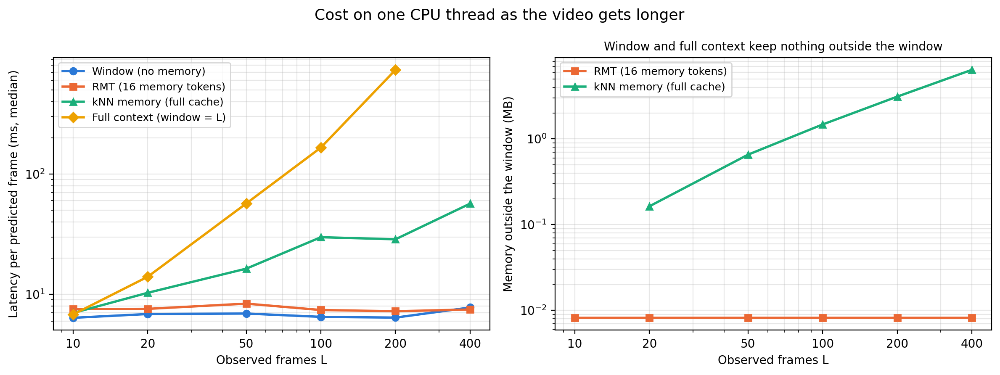
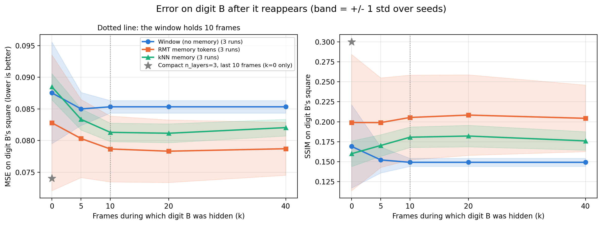
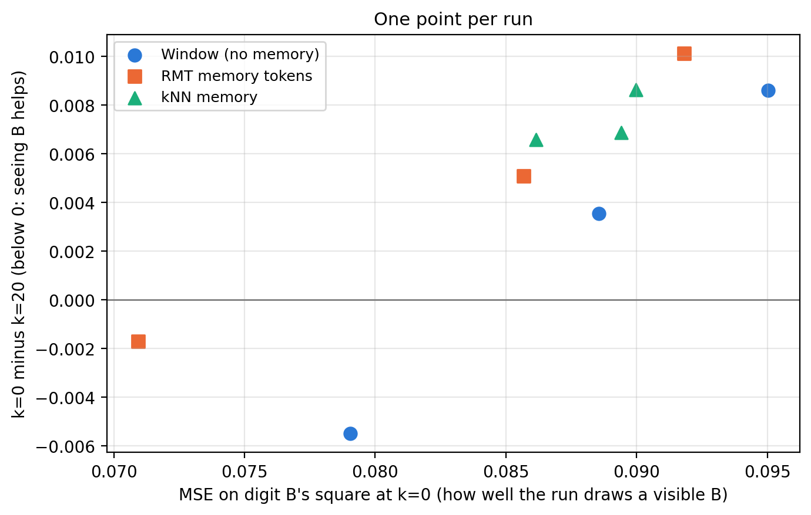
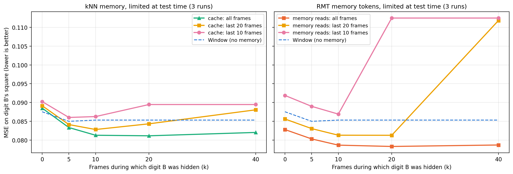
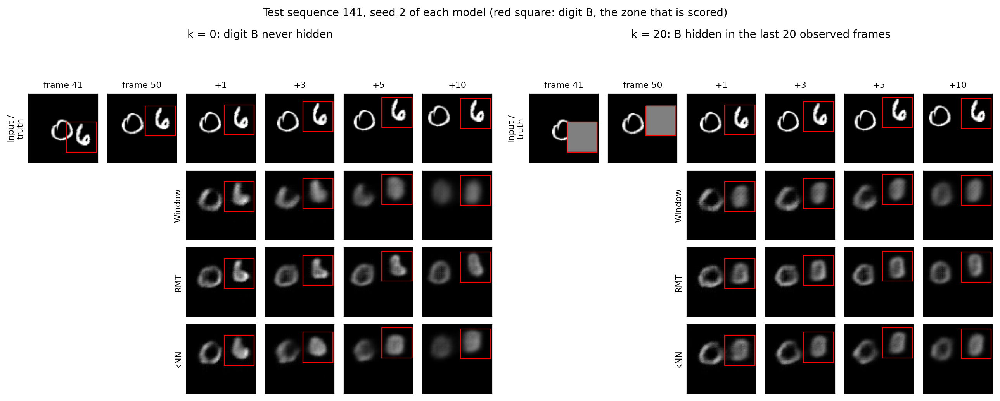

# Memory in a small video Transformer

Can a memory built into a Transformer recover something that is no
longer in its context window, and at what cost? This file has the setup,
the predictions I wrote before running anything, and the results.

## Setup

### Task: occluded Moving MNIST

50 observed frames, then 10 frames to predict. Two digits move as in the
on-the-fly Moving MNIST of the main benchmark (random velocity in
[-4, 4] px/frame on each axis, wall reflection). Digit A is always
visible. Digit B is covered by a gray square (value 0.5) that follows it
during the last k observed frames, then it is visible again in the
frames to predict. The square shows where B is, not which digit it is,
so getting B right after the occlusion is a memory test and not a
tracking test (`src/datasets/moving_mnist_occlusion.py`).

- Training: k uniform in [0, 40], fresh sequences every epoch, MNIST
  train digits.
- Test: k in {0, 5, 10, 20, 40}, 1000 fixed sequences per k, MNIST test
  digits (never seen in training).
- Main metric: SSIM and MSE on the 28x28 square of digit B in each
  predicted frame ("zone"), averaged over the 10 steps. Full-frame
  MSE/SSIM are reported too. After the runs, the MSE became the main
  metric: on these blurry predictions, SSIM rewards leaving B's square
  empty (see the results).

With a 10-frame window, the window still contains a visible B when
k < 10, and only the gray square when k >= 10.

### Models

All three share the same frame codec (the Compact n_layers=3 encoder and
decoder, 64x8x8 latent cut into 16 tokens per frame), the same
Transformer (4 blocks, d_model=128, 4 heads) and the same frame-by-frame
rollout. Only what happens to frames leaving the window changes.

| Model | Memory | Params | Cost per predicted frame |
|-------|--------|--------|--------------------------|
| Window | none, attention over the last 10 frames | 0.946M | constant |
| RMT | 16 recurrent memory tokens, written every 10 frames (Bulatov et al. 2022) | 0.950M | constant |
| kNN | cache of the keys/values of block 3, top-32 retrieval mixed with local attention by a learned gate (after Wu et al. 2022) | 0.946M | grows with the cache |

A "full context" control (window of 50 frames) is in the code, to run
only if both memories fail.

### Training

Same loop as the rest of the repo (`src/training/trainer.py`): Adam,
lr 1e-3, cosine schedule, MSE on the 10 predicted frames, batch 32,
10,000 sequences per epoch, 100 epochs, best checkpoint on validation
loss. Seeds 1, 2, 3 for each model. Unlike the older scripts, the seed is
set before the model is built, so it fixes the initialization
(`scripts/train_memory.py`, `notebooks/colab_runs.ipynb`).

## Predictions written before the runs

Precondition: the test only says something about memory if the models
redraw digit B well when it was never hidden. For the window model,
zone SSIM at k=0 must be clearly above k=40 (by 0.1 or more). A two-epoch
check on CPU showed the model learning (validation loss 0.038 -> 0.034)
but still blurry on B (zone SSIM 0.05 at k=0), so this is checked after
the first seed, before spending GPU time on the others.

- H1 (Window): zone quality is fine for k=0 and k=5, drops at k=10,
  and stays at the same low level for k=10, 20 and 40.
- H2 (kNN, full cache): the curve stays roughly flat, close to k=0.
- H3 (kNN, cache limited at test time to the last C frames that left
  the window): B is still in the cache as long as k <= 9 + C. So with
  C=20 the curve holds at k=20 and drops at k=40; with C=10 it holds at
  k=10 and drops at k=20. So H3 gives the exact k where the error
  should jump.
- H4 (RMT): better than Window for k >= 10, but it degrades as k
  grows, because 16 tokens have to keep more and more history.
- H5 (cost): latency and FLOPs per predicted frame stay flat with the
  video length for Window and RMT, grow with the cache for kNN, and grow
  faster for full context.

I mark the wrong ones in the results.

## Results

### Cost as the video gets longer

`scripts/memory_cost.py`, Intel i5-12400F, one thread, batch size 1.
For each number of observed frames L: latency of one predicted frame
once the L frames have been read (median and p95 over 30 runs after 5
warmup runs), FLOPs of that step, and the memory kept outside the
window. Models at random init (weights don't change the cost). FLOPs
here come from `torch.utils.flop_counter`, which counts a multiply-add
as 2 FLOPs (fvcore, used in the main benchmark, counts it as 1).

Latency per predicted frame, median (p95), in ms:

| Model | L=10 | L=50 | L=100 | L=200 | L=400 |
|-------|------|------|-------|-------|-------|
| Window | 6.4 (7.9) | 6.9 (7.9) | 6.5 (7.4) | 6.4 (7.4) | 7.8 (9.6) |
| RMT | 7.5 (8.7) | 8.4 (11.2) | 7.4 (9.8) | 7.2 (10.0) | 7.5 (10.2) |
| kNN | 7.0 (9.7) | 16.4 (18.6) | 29.8 (31.1) | 28.7 (35.4) | 56.7 (71.6) |
| Full context | 6.8 (7.9) | 56.9 (68.7) | 165.9 (240.9) | 733.4 (849.4) | not run |

FLOPs per predicted frame and memory outside the window:

| Model | GFLOPs, L=10 to 400 | Memory outside the window |
|-------|---------------------|---------------------------|
| Window | 0.32 at every L | 0 |
| RMT | 0.36 at every L | 8.2 kB at every L (16 tokens x 128 floats) |
| kNN | 0.32, 0.38, 0.44, 0.57, 0.84 (L=10, 50, 100, 200, 400) | 0, 0.66, 1.47, 3.11, 6.39 MB (16 kB per frame) |
| Full context | 0.32, 2.59, 7.78, 26.0 (L=10, 50, 100, 200) | 0, but the window itself grows |

H5 holds: the cost per predicted frame is flat for Window and RMT,
grows with the cache for kNN, and explodes for full context (733 ms per
frame at L=200, about 115 times the window model). The kNN latency is noisier
than its FLOP count (L=100 and L=200 give about the same time), because
the search over the cache is limited by memory reads more than by
arithmetic.

One cost doesn't show in the table: reading the observed frames. RMT
has to run every segment through the Transformer to build its memory
(382 ms for L=400, against 100 ms just to encode the frames for the
window model). That cost is paid once per video, not per predicted
frame.

### Pipeline check with Compact

Before training anything, I ran the evaluation on the existing Compact
n_layers=3 checkpoint, fed with the last 10 observed frames
(`scripts/eval_memory.py --model compact`). Compact never saw the gray
square during training, so this only checks the pipeline, not a result.

| k | 0 | 5 | 10 | 20 | 40 |
|---|---|---|---|---|---|
| Zone SSIM (digit B) | 0.300 | 0.054 | 0.043 | 0.043 | 0.043 |
| Zone MSE (digit B) | 0.074 | 0.128 | 0.154 | 0.154 | 0.154 |

As expected, it works without occlusion and falls apart as soon as the
square shows up. The numbers for k=10, 20 and 40 are exactly equal:
the test sets for different k use the same sequences, and once k >= 10
the last 10 frames are identical, so a model that only sees them gives
the same output. That's the behavior the window model should show too
(H1).

### Forgetting curve

9 runs (3 models x 3 seeds), 100 epochs each, on a Colab L4 (about
1 h 30 per wave of 3 runs). The tables and figures come from
`scripts/memory_summary.py`.

MSE on digit B's square, mean +/- std over the 3 seeds (lower is better):

| Model | k=0 | k=5 | k=10 | k=20 | k=40 |
|-------|-----|-----|------|------|------|
| Window | 0.0875 +/- 0.0080 | 0.0850 +/- 0.0026 | 0.0853 +/- 0.0010 | 0.0853 +/- 0.0010 | 0.0853 +/- 0.0010 |
| RMT | 0.0828 +/- 0.0107 | 0.0803 +/- 0.0062 | 0.0787 +/- 0.0052 | 0.0783 +/- 0.0049 | 0.0787 +/- 0.0042 |
| kNN | 0.0885 +/- 0.0021 | 0.0834 +/- 0.0017 | 0.0813 +/- 0.0015 | 0.0812 +/- 0.0015 | 0.0820 +/- 0.0013 |
| Compact n_layers=3 (pipeline check) | 0.0740 | | | | |

Once B is hidden (k >= 10), both memories stay below the window model:
0.0812 for kNN and 0.0783 for RMT at k=20, against 0.0853. The window
model gives the same numbers for k = 10, 20 and 40 to 7 decimals, since
its 10 frames are then identical. That confirms it sees nothing older.

The SSIM curves are in the right half of the figure and in
`results/memory_summary.json`. I don't draw conclusions from them: a run
that leaves B's square nearly empty gets a better SSIM than one that
draws a wrong digit there, the same trap as the black frame on Moving
MNIST (Phase 6 in `RESULTS.md`). The full-frame SSIM per step without
occlusion is in `figures/memory_per_step.png`.

#### The precondition failed, and why

The check planned before the runs (window zone SSIM at k=0 at least 0.1
above k=40) failed on the first seed: 0.122 at k=0 against 0.144 at
k=40. The MSE goes the same way. For 7 runs out of 9, the error on B is
higher at k=0 than at k=20: a model that sees B does worse than a model
that only saw a gray square.

Two things explain it, and the check could not tell them apart.

1. The gray square follows B exactly. When B is hidden, the model still
   gets a clean, solid marker of B's position and speed. At k=0 it has
   to find B from the digit itself, often overlapping digit A. So going
   from k=0 to k=10 changes two things at once: B's shape disappears,
   and its position gets easier to read. On top of that, k=0 is only 1
   training sequence in 41.
2. The models are blurry. They redraw a visible B for 1 to 3 frames,
   then it turns into a blob that drifts (pictures below). A wrong shape
   costs more MSE than the vague oval at the right place that they draw
   when B is hidden.

Looking at each run, the two where k=0 does beat k=20 are the two that
draw a visible B best:
RMT seed 2 (0.0709 at k=0) and window seed 3 (0.0790). All the others
are above 0.085.

Seeds 2 and 3 were still run. Part of the failure came from the
reference itself (k=0 is not the easy case it was supposed to be), and
the controls below compare conditions without using k=0. The other
part is the blur, and it is there in everything below.

### Test-time controls

Both memories can be limited at test time, without retraining. The kNN
cache keeps only the last C frames that left the window
(`cache_frames`), and the RMT memory starts from scratch and only reads
the last C frames before the window (`memory_frames`). B is then
available to the memory as long as k <= 9 + C. Comparing k=10 and k=20
with C=10, or k=20 and k=40 with C=20, keeps the window and the number
of frames read the same. Only whether those frames show B changes.

Error on B with B in what the memory kept, then without it:

| Model | Seed | C=10: k=10 -> k=20 | C=20: k=20 -> k=40 |
|-------|------|-------------------|-------------------|
| kNN | 1 | 0.0843 -> 0.0894 (+6.0%) | 0.0836 -> 0.0882 (+5.6%) |
| kNN | 2 | 0.0882 -> 0.0891 (+1.1%) | 0.0845 -> 0.0874 (+3.5%) |
| kNN | 3 | 0.0864 -> 0.0899 (+4.1%) | 0.0850 -> 0.0886 (+4.2%) |
| RMT | 1 | 0.0897 -> 0.1192 (+32.9%) | 0.0844 -> 0.1206 (+42.8%) |
| RMT | 2 | 0.0846 -> 0.1003 (+18.6%) | 0.0770 -> 0.0972 (+26.3%) |
| RMT | 3 | 0.0865 -> 0.1178 (+36.3%) | 0.0825 -> 0.1176 (+42.6%) |

The error goes up in all 12 cases. For RMT the jump is exactly where
the k <= 9 + C rule puts it, and the curve is flat before it. For kNN
the jumps are small, and with C=20 the curve already rises a little
before the predicted point (0.0828 at k=10, 0.0843 at k=20, 0.0881 at
k=40). With the full cache, kNN stays flat from k=10 to k=40.

The two memories react very differently. kNN loses 1 to 6% and lands
close to the window model (0.0895 against 0.0853, mean over seeds with
C=10). RMT loses 19 to 43% and ends up well above the window model
(0.1125): with a memory that never saw B, it does worse than with no
memory at all. During training its memory always read frames where B
was visible, since k <= 40 leaves B visible in at least the first 10
frames. A memory without B is a situation RMT never met, so these
numbers show that it relies on its memory, but they overstate how much
it knows about B. kNN mixes what it retrieves with local attention
through a learned gate, which probably lets it fall back on the window
when the retrieved frames don't help.

The RMT control was computed on CPU from the Colab checkpoints
(`scripts/eval_memory.py --model rmt`). Its "all frames" curve matches
the Colab numbers to 4 decimals.

### What the models draw

One test sequence, the first of the 5 (out of 1000) where the two digits
never overlap in the frames to predict. One figure per seed, so that
none is picked after looking:

Seeds 1 and 3: `figures/memory_examples_seed1.png`,
`figures/memory_examples_seed3.png` (`scripts/memory_examples.py`).

When B is visible, the three models redraw a recognizable 6 for 1 to 3
frames, then a blob. Only RMT seed 2 keeps the 6 until the last frame.
After 20 hidden frames, no model redraws the 6, with or without memory.
They all draw a generic oval at the position given by the square. The
effect is in the numbers, but I can't see it in the pictures.

### Predictions against results

- Precondition: failed (see above).
- H1 (Window): wrong. There is no drop at k=10: 0.0875, 0.0850 and
  0.0853 at k = 0, 5, 10, within the spread over seeds. The second half
  (same level for k = 10, 20, 40) holds exactly.
- H2 (kNN, full cache): the flat curve holds (0.0813, 0.0812,
  0.0820). "Close to k=0" fails, for the reasons above.
- H3 (kNN, limited cache): holds. The error goes up where predicted
  in 6 cases out of 6, and RMT follows the same rule. The effect is
  small, 4% on average.
- H4 (RMT): half right. Better than Window for k >= 10 (0.0783
  against 0.0853), but also better at k=0, and its seeds vary a lot
  (0.0726 to 0.0817 at k=20). It does not degrade with k (0.0787,
  0.0783, 0.0787 at k = 10, 20, 40), so with 40 frames before the
  window the 16 tokens don't lose anything I can measure.
- H5 (cost): holds (see above).

So both memories keep some information about a digit that left the
window, and the test-time controls show it without retraining. It is
not enough to redraw the digit, though. To get a real answer I would
need sharper models first (all 9 runs had their best validation loss in
the last two epochs, so they were still learning), and an occluder that
also hides the position (the `vanish` mode is already in the dataset).

## Limits

- A toy problem: MNIST digits, 64x64 frames, models of about 1M
  parameters. Nothing here says how these memories behave in a language
  model.
- The kNN memory is a simplified Memorizing Transformer: exact search
  over a small cache, one model size, and keys for the frames older than
  the window computed segment by segment.
- RMT uses one set of memory tokens that are both read and written
  (encoder-style), not the separate read and write tokens of the
  decoder version.
- Latency is measured on an x86 desktop CPU, one thread, batch size 1.
- 3 seeds per model, and they vary a lot (RMT validation loss from
  0.0205 to 0.0237). All runs were still improving at epoch 100.
- The zone is B's square, but in 995 of the 1000 test sequences digit A
  enters it at some point in the 10 predicted frames, so the error on B
  also contains part of A. The sequences are the same for every k and
  every model, so this adds noise, not a bias between conditions.
- MSE replaced SSIM as the main metric after looking at the results.
  The SSIM numbers are still reported.
- The RMT control puts the model in a situation it never met in
  training (a memory without B), so its effect size is overstated.
- The full-context control (window of 50 frames) was not trained.
