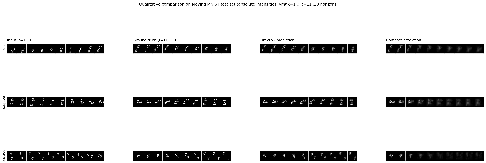
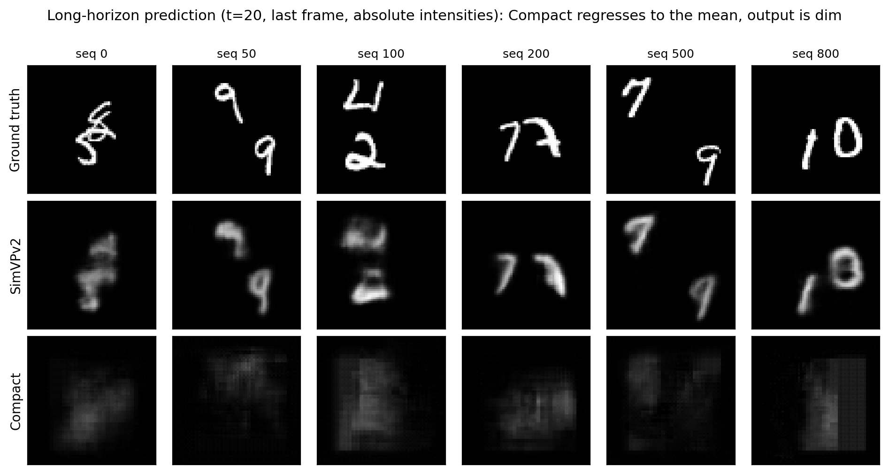
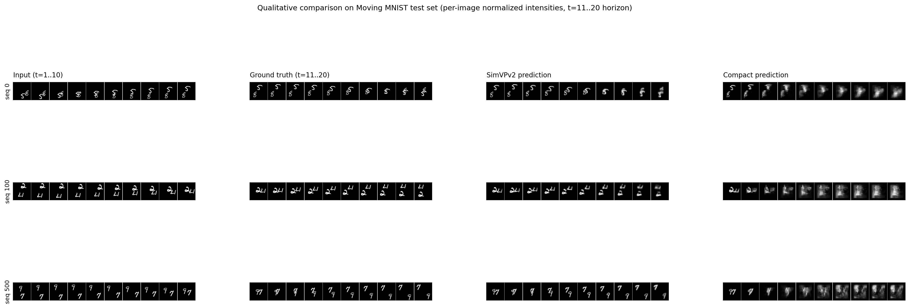
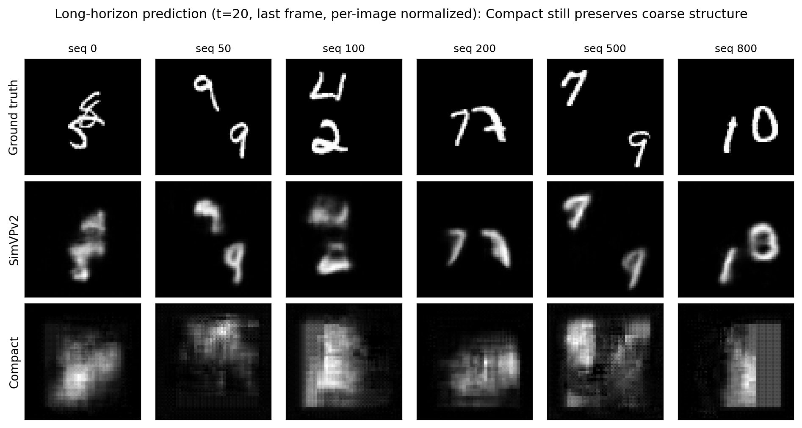
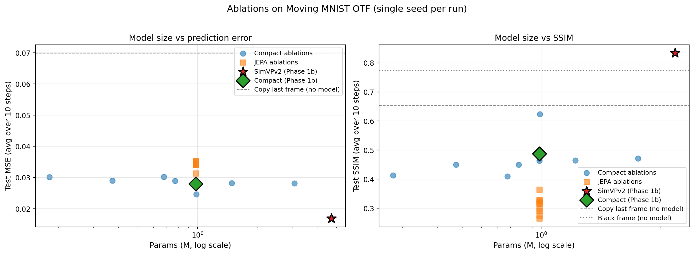
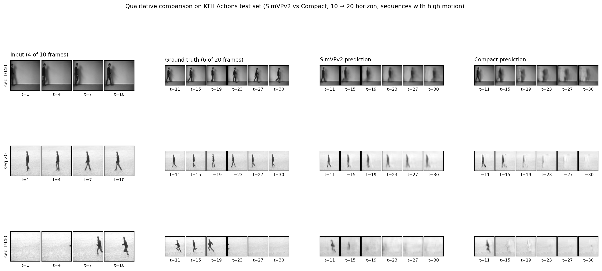
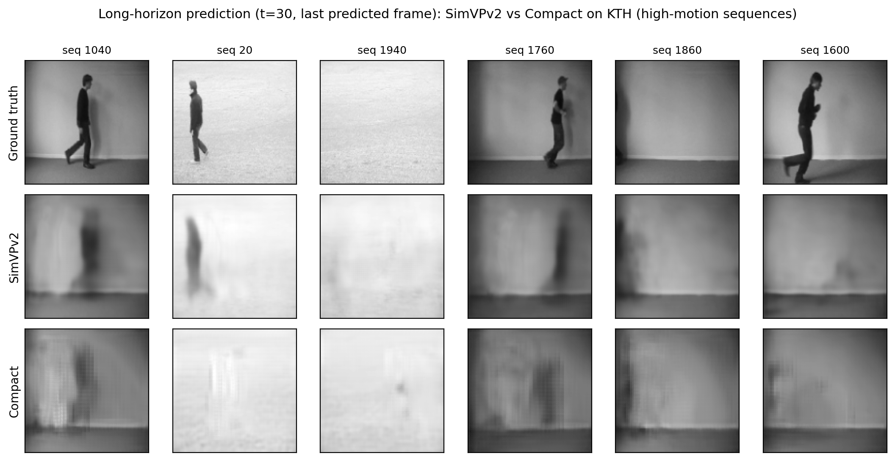

# Modern Video Prediction Benchmark with Compact Latent Dynamics

Small PyTorch benchmark for future frame prediction. I compared SimVPv2
(the gSTA model from OpenSTL, in a small 4.7M-parameter configuration)
against a compact latent dynamics model I designed myself, first on
Moving MNIST and then on KTH Actions.

What I wanted to find out: how much quality a small video prediction
model keeps (the kind you could run on an embedded device), where it
loses it, and why. I first compared it to SimVPv2 on Moving MNIST and
KTH, then checked that the metrics weren't flattering it, which led to
trivial baselines and to scoring KTH on the moving pixels only. The
ablations and Phase 6 look for the cause of the blur. Phases 3 and 7
try predicting in latent space instead (JEPA), which didn't help here.
Phase 8 makes the model lighter with int8, and the memory extension
asks whether a cheap memory lets it use frames older than its window.

## Main result on Moving MNIST

On the on-the-fly setup (200 epochs), the compact model is about 5x
smaller than SimVPv2 (4.72M -> 0.98M params) and ~3x cheaper in FLOPs.
It pays for this in long-horizon SSIM. The ablations later showed that
bumping n_layers from 2 to 3 in the encoder closes about half of the
SSIM gap, at the same size.

| Model                          | Params | Test MSE | Test SSIM |
|--------------------------------|--------|----------|-----------|
| Copy last frame (no model)     | 0      | 0.0699   | 0.65      |
| Black frame (no model)         | 0      | 0.0425   | 0.77      |
| SimVPv2 (gSTA, small config)   | 4.72M  | 0.0169   | 0.83      |
| Compact (n_layers=2, baseline) | 0.98M  | 0.0279   | 0.49      |
| Compact (n_layers=3)           | 0.99M  | 0.0239   | 0.65      |

Test MSE and SSIM are averaged over the 10 predicted frames of the
Toronto test set. All rows were recomputed from the saved checkpoints
with `scripts/reevaluate_checkpoints.py`.

At the same budget (200 epochs), going from n_layers=2 to n_layers=3
adds 0.01M params and moves SSIM from 0.49 to 0.65 (+32%) and MSE from
0.0279 to 0.0239. That closes 46% of the SSIM gap and 37% of the MSE
gap to SimVPv2. The model also gets cheaper, because the latent is 8x8
instead of 16x16 (0.15G FLOPs instead of 0.46G). Three ablation runs
happen to share the default config and land within 0.012 SSIM of each
other, so the n_layers effect is far above run-to-run noise.

The first two rows are sanity checks, and they matter for reading
SSIM. Copying the last input frame gets SSIM 0.65, as high as Compact
n_layers=3, but its MSE is 2.5 to 4 times worse than the trained
models. The background is black, so a sharp digit in the wrong place
keeps a high SSIM and a blurry one loses it. An all-black frame even
gets 0.77, more than any Compact model. That's why I always look at
both metrics.

Why does Compact blur in the first place? I tested it with
predictions written before each run (Phase 6 in `RESULTS.md`):

- My first guess was that its translator (a single 3x3 conv in the
  latent) can't move information as far as the digits travel. A test
  with fixed digit speeds rejected it: Compact blurs just as much when
  the digits move 1 pixel per frame.
- Adding SimVP's skip connection changes nothing.
- An L1 loss looked like a fix (SSIM 0.79), but from step 5 on it
  scores exactly like an all-black frame: it makes the digits disappear.
- A dilated 3x3 in the translator, same size and cost, recovers about
  half of the n_layers=3 gain. So part of that gain comes from a window
  wide enough to see a whole digit.

The n_layers=3 result holds over 3 runs against 3 (SSIM 0.620 +/-
0.004 against 0.470 +/- 0.006).

Full per-step metrics, ablations and JEPA experiments are in
`RESULTS.md`.

## Main result on KTH Actions

KTH looks like a very different story at first. I used a smaller
Compact config here (translator_hidden=128 instead of 256), which puts
it at 0.37M params, roughly 13x smaller than SimVPv2 at 128x128. On
full-frame metrics the gap almost disappears:

| Horizon | Copy last frame | SimVPv2 MSE | Compact MSE | Compact / SimVPv2 |
|---------|-----------------|-------------|-------------|-------------------|
| t=1     | 0.00097         | 0.00093     | 0.00093     | 1.01x             |
| t=10    | 0.00498         | 0.00245     | 0.00324     | 1.32x             |
| t=20    | 0.00585         | 0.00359     | 0.00394     | 1.10x             |

Same MSE at t=1, and even after 20 autoregressive steps the Compact
model is only ~10% behind. The copy-last-frame column puts this in
perspective. At t=1 the next frame is almost identical to the last
one, so copying it is nearly as good as both models and the t=1 tie
doesn't say much. The models pull away from the copy later: at t=10,
SimVPv2 halves the copy's error and Compact cuts it by a third. On
SSIM averaged over the 20 steps, the copy (0.81) sits between SimVPv2
(0.82) and Compact (0.80), because a copy is perfectly sharp.

The full-frame numbers are mostly background, though. The background doesn't
move, and the person, the only thing that does, covers 1% to 6% of the
frame. So I also scored the models only on the pixels that change
between the last observed frame and the true future frame
(`scripts/kth_motion_eval.py`):

| Moving pixels only | Copy last frame | SimVPv2 | Compact |
|--------------------|-----------------|---------|---------|
| MSE, average over 20 steps | 0.089 | 0.027 | 0.035 |
| Sharpness at t=20 (1 = as sharp as the truth) | 1.02 | 0.37 | 0.37 |

Both models are far better than copying, but both blur the person: by
t=20 their predictions keep only 37% of the edge sharpness of the true
frames, and SimVPv2 is no sharper than Compact. On these pixels,
Compact's error is 29% above SimVPv2's, against 14% on the full frame.
So "the gap disappears on KTH" only holds for metrics dominated by the
background.

I also tried n_layers=3 on KTH (since it worked so well on MMNIST). On
the full frame it doesn't help (average SSIM 0.77 against 0.80). On the
moving pixels its error is a bit lower than the three baseline runs I
have now (0.032 against 0.033 to 0.035), but it is blurrier at t=1, and
it's a single run.

The Phase 6 variants on KTH (`RESULTS.md`) go the same way as on MNIST.
SimVP's skip connection, useless on MNIST, improves the full frame here
but not the moving person, since it mostly carries the static
background. A dilated translator lowers the error on moving pixels a
little, like n_layers=3. And the L1 loss gets the best full-frame SSIM
of all models, SimVPv2 included, while doing worst on the moving pixels.
None of them gets close to SimVPv2 where things move.

All KTH numbers were recomputed from the checkpoints on the 5,097 test
clips. The Phase 2 numbers match the original eval runs.

## Computational efficiency

Forward pass on one CPU thread (`torch.set_num_threads(1)`),
batch_size=1, 64x64 input, Intel i5-12400F desktop. Latency is the
median over 30 runs after 5 warmup runs, with the 95th percentile in
brackets:

| Metric        | SimVPv2      | Compact        | Compact n_layers=3 |
|---------------|--------------|----------------|--------------------|
| Parameters    | 4.72M        | 0.98M          | 0.99M              |
| FLOPs         | 1.50G        | 0.46G          | 0.15G              |
| CPU latency   | 56 ms (60)   | 13.6 ms (15.6) | 6.6 ms (8.6)       |

Compact is about 4x faster than SimVPv2, and n_layers=3 about 8.5x.
Running the benchmark twice gave the same numbers within a few
percent.

`RESULTS.md` also has older measurements on a laptop i7 (25 ms vs
5.9 ms) and a Colab Xeon, with a similar 4x ratio. That script didn't
set the number of threads, so those runs probably used several cores:
the ratio holds, the absolute numbers aren't comparable.

I also tried static post-training int8 quantization of Compact
n_layers=3 (PyTorch FX, oneDNN backend), one part at a time (Phase 8
in `RESULTS.md`). Quantizing the translator alone, which holds 93% of
the parameters, divides the saved weights by 3.2 (3.95 to 1.22 MB) with
no measurable change in MSE or SSIM. But int8 was 9% to 41% slower than
fp32 here: the model is tiny, and GELU and GroupNorm stay in fp32, so
each quantized block adds conversions. The decoder's transposed convs
stay in fp32 as well, because the int8 ConvTranspose2d kernel of this
PyTorch build gave outputs 195% off in relative MSE.

## What's in this repo

- SimVPv2 baseline plugged into a clean PyTorch training/eval pipeline
  (model code is from OpenSTL with attribution, see below)
- Compact latent dynamics model (encoder -> latent transition -> decoder)
- JEPA-style variant of the Compact model, with EMA target encoder
  and VICReg-style regularization
- Multi-step evaluation with MSE and SSIM
- Two Moving MNIST setups: fixed Toronto split and on-the-fly generation
- Extension to KTH Actions
- 21 ablation runs (10 Compact + 11 JEPA)
- Model size vs quality plot for all ablation runs
- A script that re-evaluates every Moving MNIST checkpoint, with a
  copy-last-frame baseline
- A fixed-speed version of Moving MNIST, to test where the blur comes
  from (Phase 6)
- A KTH evaluation restricted to the pixels that move, since the static
  background dominates full-frame metrics
- Post-training int8 quantization of Compact n_layers=3, part by part
  (Phase 8)
- A memory extension: occluded Moving MNIST, a window Transformer, RMT
  memory tokens and a kNN memory, with a forgetting curve and a cost
  benchmark (`MEMORY_RESULTS.md`)
- Qualitative figures and a simple efficiency benchmark

## Project structure

    src/
      config.py
      datasets/         # MovingMNIST, MovingMNISTOnTheFly, KTHActions,
                        # MovingMNISTFixedSpeed, MovingMNISTOcclusion
      models/
        base.py
        simvpv2/        # baseline (from OpenSTL, see ATTRIBUTION.md)
        compact/        # my compact model
        compact_jepa/   # JEPA-style variant
        transformer_window/  # memory extension: codec, attention, window model
        transformer_rmt/     # + recurrent memory tokens
        transformer_knn/     # + kNN memory
      training/
        trainer.py
        jepa_trainer.py # JEPA-specific training loop
      evaluation/
    scripts/            # download, train, eval, benchmark scripts
    ablations/          # JSON summaries of the 21 ablation runs
      compact/          # 10 Compact ablations
      jepa/             # 11 JEPA ablations
    results/            # re-evaluation, Phases 6 to 8, memory runs
    notebooks/          # Colab notebook for all the GPU runs
    splits/kth/         # the exact KTH clip lists (train / val / test)
    tests/              # pytest checks (memory models, resuming a run)
    data/               # datasets (not committed)
    checkpoints/        # not committed
    figures/            # qualitative comparisons + size vs quality plot
    RESULTS.md

## How to reproduce

Tested with Python 3.10. Training scripts log to Weights & Biases by
default; set `WANDB_MODE=disabled` in your env to skip that.

```bash
git clone <repo>
cd video-prediction-benchmark
pip install -r requirements.txt

# Moving MNIST (fixed split)
python scripts/download_mmnist.py
python scripts/train_simvpv2_mmnist.py
python scripts/train_compact_mmnist.py
python scripts/eval_simvpv2_mmnist.py
python scripts/eval_compact_mmnist.py

# Moving MNIST (on-the-fly)
python scripts/train_simvpv2_mmnist_otf.py
python scripts/train_compact_mmnist_otf.py
python scripts/eval_simvpv2_mmnist_otf.py
python scripts/eval_compact_mmnist_otf.py

# KTH Actions
python scripts/download_kth.py
python scripts/extract_kth_frames.py
python scripts/generate_kth_splits.py
python scripts/kth_to_npy.py --kth-root data/kth   # optional, faster loading
python scripts/train_simvpv2_kth.py
python scripts/train_compact_kth.py
python scripts/eval_simvpv2_kth.py
python scripts/eval_compact_kth.py

# Efficiency benchmark
python scripts/benchmark_efficiency.py

# JEPA-style training
python scripts/train_jepa_mmnist.py          # default hyperparameters
python scripts/train_jepa_mmnist_best.py     # best hyperparameters from ablations
python scripts/eval_jepa_mmnist.py

# Ablations
python scripts/ablations_compact.py --axis all --n_epochs 100
python scripts/ablations_jepa.py --axis all --n_epochs 100
python scripts/reevaluate_checkpoints.py --kth-root data/kth   # writes results/ and ablations/
python scripts/generate_pareto_plot.py

# Compact with n_layers=3 (best ablation finding)
python scripts/train_compact_mmnist_otf_n3.py
python scripts/eval_final.py    # evaluates both JEPA-best and Compact-n3

# Phase 6: why Compact blurs
python scripts/phase6_speed_test.py          # CPU, existing checkpoints
python scripts/phase6_train.py --variant skip --seed 1   # GPU, see notebooks/colab_runs.ipynb
python scripts/phase6_train_kth.py --variant skip --seed 1   # GPU, same on KTH
python scripts/kth_motion_eval.py --kth-root data/kth        # KTH, moving pixels only
python scripts/phase6_summary.py --import-phase4

# Phase 7: JEPA collapse check and linear probe (CPU)
python scripts/jepa_diagnostic.py collapse --data-root data --ckpt-root checkpoints
python scripts/jepa_diagnostic.py probe --data-root data --ckpt-root checkpoints

# Phase 8: int8 quantization (CPU)
python scripts/quantize_int8.py --data-root data --ckpt-root checkpoints

# Memory extension
pytest tests/
python scripts/train_memory.py --model knn --seed 1   # GPU, see notebooks/colab_runs.ipynb
python scripts/eval_memory.py --model rmt --ckpt checkpoints/memory-rmt-seed1/best.pt \
    --out results/memory/eval-rmt-seed1.json           # RMT memory control, CPU
python scripts/memory_summary.py
python scripts/memory_examples.py --seed 1             # what the models draw
python scripts/memory_cost.py                          # CPU, one thread
```

Phases 1 to 5 were trained on a single H100 GPU through Colab, Phase 6
and the memory runs on a Colab L4.

## Visual comparison - Moving MNIST



For 3 fixed test sequences, this figure shows input frames, ground
truth, SimVPv2 predictions and Compact predictions side by side over
the 10-step horizon (raw intensities, same scale as ground truth).



At t=20, SimVPv2 still keeps the digit structure intact while the
Compact predictions go very dark. It's not a rendering issue: the
Compact model regresses toward the dataset mean at long horizons, so
the output amplitude collapses. This is consistent with the SSIM gap
at t=10 (~0.34 Compact vs ~0.75 SimVPv2 on the OTF split). Moving MNIST
is deterministic given the past, but a small model can't track the
digits precisely: velocity estimates drift, digits overlap, and errors
pile up over the rollout. With an MSE loss, the safest answer under
that uncertainty is an average of the possible positions, which looks
like a dark blur.

To check that the model wasn't just outputting noise, I re-rendered
the same figures with per-image contrast normalization:





The normalized view shows the predictions still hold a coarse memory
of where the digits were, so the model is actually predicting
something - the amplitude is just very low. You can also see the
typical ConvTranspose2d checkerboard artifact (Odena et al. 2016).
Replacing transposed convs with Upsample + Conv2d would be a clean
fix for a v2.

For the regression-to-the-mean issue I tried two different things: a
JEPA-style training scheme (loss in latent space), and a simple
architectural tweak (n_layers=3). The architectural one worked much
better, which honestly I wasn't expecting.

## JEPA-style training

The idea was to attack the regression-to-the-mean problem by training
in latent space instead of pixel space, following the JEPA recipe
(Assran et al. 2023): online encoder + EMA target encoder, prediction
loss between latents, VICReg-style anti-collapse term.

I ran 11 ablations to find decent hyperparameters, then retrained the
best config. It did not beat the pixel-space Compact baseline. Best
SSIM was 0.39, against 0.49 for Compact n_layers=2 and 0.65 for
n_layers=3 (all at 200 epochs).

A few things I noticed from the ablations:

- The run without variance regularization (var_coef=0) had the best
  SSIM, 0.36. The four ablation runs that use the default config go
  from 0.26 to 0.32, so this is a hint more than a result.
- The EMA momentum runs don't show a clear trend. 0.999 gives 0.32,
  which is inside that 0.26-0.32 spread, and 0.99 (0.27) did better
  than 0.996 (0.26).
- JEPA was designed for large-scale self-supervised pretraining
  (V-JEPA uses 200M+ params), and I'm running a 0.98M supervised
  model. That's well outside the regime it was designed for, which
  may be part of why it underperformed.

I judged the JEPA through the SSIM of a decoder trained on detached
latents, which isn't what a JEPA is trained for, so I checked it again
later without retraining (Phase 7 in `RESULTS.md`). No encoder
collapsed completely. The runs without the variance term are as rich
as Compact's encoder, the ones with it use far fewer dimensions. Then
a linear probe read the future digit positions from the predicted
latents. The best JEPA is still behind Compact (8.1 px vs 6.1 px of
error 10 frames ahead), and the runs with the variance term do worse
than the same model with random weights. So the negative result holds
with an evaluation that suits a JEPA too.

Model size vs quality for 20 of the 21 ablation runs (the
decoder_coef=0 run has no pixel output), one seed each:



## Visual comparison - KTH Actions



For 3 high-motion KTH test clips, this figure shows the same
side-by-side comparison over the 20-step horizon.



By the last predicted frame, both models have turned the person into a
blur. SimVPv2 still keeps a smeared silhouette in most clips, while
Compact often loses the person into the background, with the
checkerboard pattern of its transposed convolutions on top. That
matches the sharpness measured on the moving pixels (37% for both at
t=20): full-frame numbers make KTH look easier than it is.

## Extension: memory in a small video Transformer

A Transformer only sees its context window. I wanted to check whether a
memory built into the model lets it recover something that left the
window, and what that costs.

The test is a variant of Moving MNIST. The model sees 50 frames and
predicts the next 10. One of the two digits is covered by a gray square
during the last k observed frames, then shows up again. The square
follows the digit, so the model knows where it is but not which digit
it is. With a 10-frame window and k >= 10, a model without memory has
no way to know what to redraw.

Three models share the same encoder and decoder (from Compact), the
same small Transformer (0.95M params) and the same training loop. Only
the memory changes:

- Window: attention over the last 10 frames, no memory
- RMT: 16 memory tokens carried from one segment to the next (Bulatov
  et al. 2022), constant cost
- kNN: a cache of past keys and values, each query attends to its 32
  nearest keys, mixed with local attention by a learned gate (after
  Memorizing Transformers, Wu et al. 2022), cost grows with the cache

Results, 3 seeds per model. Both memories keep some information about
the digit once it has left the window. When I limit the memory at test
time so that it no longer contains the digit, the error on that digit
goes up in every run: +1 to +6% for kNN, +19 to +43% for RMT (too high,
because RMT never trained without the digit in its memory). But no
model redraws a recognizable digit after 20 hidden frames, the models
are too blurry for that.

On cost, Window and RMT stay between 6 and 9 ms per predicted frame up to 400
observed frames. kNN grows to 57 ms and 6.4 MB of cache, and full
attention takes 733 ms at 200 frames.

The predictions I wrote before running, the setup and the full results
(including a precondition that failed, and why) are in
`MEMORY_RESULTS.md`.

## Takeaway

On real video (KTH), Compact stays close to SimVPv2 on full-frame
metrics with ~13x fewer params. But those metrics mostly score the
static background: on the pixels that move, Compact's error is about
30% higher, and both models blur the person at long horizons. On
Moving MNIST, Compact blurs toward the mean much more than SimVPv2.

On MMNIST, the simple n_layers 2 -> 3 tweak closed 46% of the SSIM gap
at the same training budget, and made the model cheaper. JEPA-style
training didn't help in my setup. On KTH the same tweak doesn't help
on the full frame and gives mixed results on the moving pixels.

One caveat: up to Phase 5, every configuration was trained with a
single seed, and the seed was set after the model was built, so the
weight initialization wasn't controlled either. The repeated default
runs in the ablations give an idea of the noise: about 0.01 SSIM for
Compact, 0.06 for JEPA. Phase 6 repeats the two main MMNIST
configurations (n_layers 2 and 3, 3 runs each, 0.470 +/- 0.006 against
0.620 +/- 0.004), and the memory extension uses 3 seeds per model.

## Attribution

The SimVPv2 model code (with the gSTA token-mixer) comes from the
OpenSTL benchmark by Tan et al. (2023), Apache 2.0. See
`ATTRIBUTION.md`. Everything else - datasets, training pipeline,
Compact model, evaluation, benchmark scripts, figures - is mine.

## Notes

I kept the code short and only compared what I could actually run.

A few natural next steps:

- Benchmarking on embedded ARM hardware, to actually validate the
  embedded deployment claim. Phase 8 only measured int8 on an x86
  desktop CPU, where it saves memory but not time.
- Hybrid latent + pixel loss for JEPA. The strict stop-gradient on
  the auxiliary decoder might be too restrictive; letting the latent
  predictor and the decoder co-adapt could help.
- RGB datasets (UCF-101, BAIR Robot Pushing) to check whether the
  architectural findings transfer beyond grayscale.
- Action-conditioned video prediction, with control inputs feeding
  into the latent transition (relevant for drone-style deployment).
