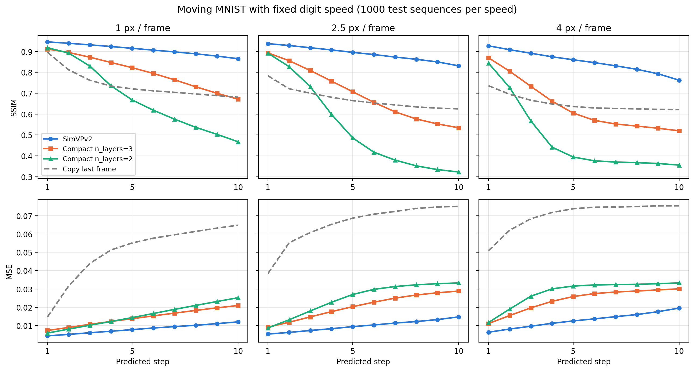
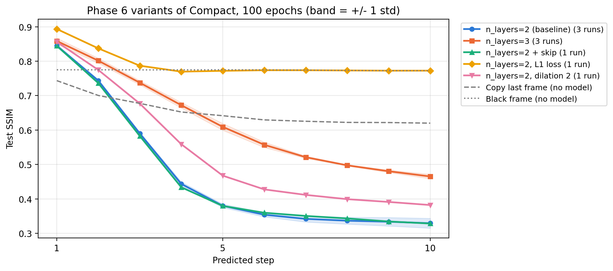
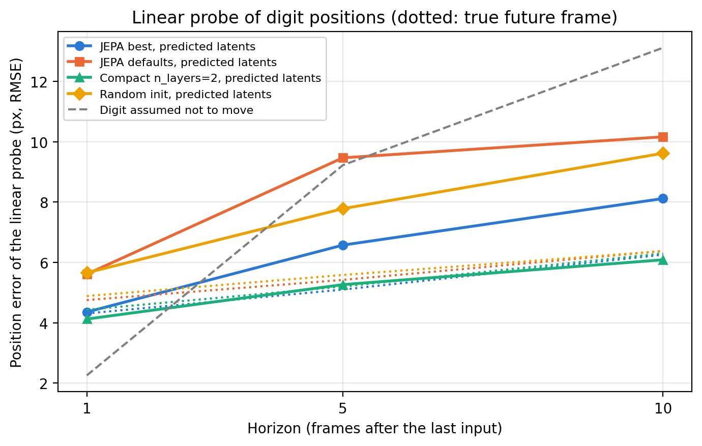

# Results

This file has the detailed metrics, training settings and discussion
for each phase of the benchmark. The high-level summary is in
`README.md`.

The benchmark compares SimVPv2 (the gSTA model from the OpenSTL
benchmark, used here in a small configuration, see Phase 1b) against a
compact latent dynamics model I designed.
Both models share the same encoder-translator-decoder structure, so
the comparison stays as direct as I could make it. The real difference
is the translator: MetaFormer with gSTA on one side, a small 1x1 ->
3x3 -> 1x1 bottleneck on the other.

The phases reported below are:

1. Phase 1: Moving MNIST with the fixed Toronto split (8000 train).
2. Phase 1b: Moving MNIST with on-the-fly sequence generation.
3. Phase 2: KTH Actions, a real-video benchmark.
4. Phase 3: JEPA-style training (Moving MNIST).
5. Phase 4: architecture and training ablations (21 runs).
6. Phase 5: cross-dataset validation of the best ablation finding.
7. Phase 6: why Compact blurs (speed test, then targeted runs on
   Moving MNIST and KTH).
8. Phase 7: JEPA revisited, collapse check and linear probe.
9. Phase 8: post-training int8 quantization of Compact n_layers=3.

There's also a separate section for computational efficiency
(parameters, FLOPs, CPU latency). The memory extension has its own
file, `MEMORY_RESULTS.md`.

Training was done in PyTorch on Colab, on a single H100 GPU for
Phases 1 to 5 and on an L4 for Phase 6.

### Note on Compact configurations

I used two slightly different Compact configurations across phases:

- Moving MNIST (Phase 1, 1b): `latent_dim=64, translator_hidden=256,
  n_layers=2` -> 0.98M params at 64x64.
- KTH Actions (Phase 2): `latent_dim=64, translator_hidden=128,
  n_layers=2` -> 0.37M params at 128x128.

I went with a smaller translator on KTH because the motion is slow and
the background is mostly static, so I figured a smaller predictor
should still be enough.

## Phase 1 - Moving MNIST: Comparison

### Configuration
- 200 epochs, batch_size=32, lr=1e-3, cosine LR schedule, Adam + MSE
- 8000/1000/1000 train/val/test split (Toronto .npy)
- H100 GPU
- Best checkpoint selected on validation loss

### Best validation loss

| Model | Params | Best val loss | Best epoch |
|-------|--------|---------------|------------|
| SimVPv2 (gSTA) | 4.72M | 0.02127 | 10 |
| Compact (ours) | 0.98M | 0.03098 | 10 |

### Test set metrics - per-step

| Step | SimVPv2 MSE | SimVPv2 SSIM | Compact MSE | Compact SSIM |
|------|-------------|--------------|-------------|--------------|
| 1 | 0.01071 | 0.8643 | 0.01421 | 0.8234 |
| 2 | 0.01400 | 0.8295 | 0.02125 | 0.7088 |
| 3 | 0.01705 | 0.7874 | 0.02740 | 0.5462 |
| 4 | 0.01970 | 0.7494 | 0.03238 | 0.3597 |
| 5 | 0.02227 | 0.7215 | 0.03499 | 0.2492 |
| 6 | 0.02414 | 0.7038 | 0.03639 | 0.2187 |
| 7 | 0.02533 | 0.6830 | 0.03714 | 0.2057 |
| 8 | 0.02634 | 0.6691 | 0.03741 | 0.1921 |
| 9 | 0.02741 | 0.6504 | 0.03732 | 0.1938 |
| 10 | 0.02812 | 0.6238 | 0.03712 | 0.1989 |

### Key horizons

| Horizon | SimVPv2 | Compact | Compact / SimVPv2 |
|---------|---------|---------|-------------------|
| t=1  | MSE 0.0107 / SSIM 0.86 | MSE 0.0142 / SSIM 0.82 | MSE x 1.33 |
| t=5  | MSE 0.0223 / SSIM 0.72 | MSE 0.0350 / SSIM 0.25 | MSE x 1.57 |
| t=10 | MSE 0.0281 / SSIM 0.62 | MSE 0.0371 / SSIM 0.20 | MSE x 1.32 |

### Discussion

In this first Moving MNIST setup the Compact model stays reasonably
close to SimVPv2 in MSE, which is decent given that it uses about 5x
fewer parameters. The clear weak point is SSIM: after t=5 or so, the
gap really opens up. That matched what I saw visually too - the
Compact model gets blurry at long horizons while SimVPv2 keeps the
digits looking sharp.

One thing bothered me here: both models hit their best validation
loss extremely early (epoch 10 out of 200). That looked more like a
data-diversity issue than under-training - the fixed 8000-sequence
split probably wasn't enough. So I ran a second phase with on-the-fly
sequence generation to check.

## Phase 1b - Moving MNIST with on-the-fly generation

### Setup
On-the-fly generation following Srivastava et al. (2015): 2 MNIST digits per sequence, random initial position, constant velocity sampled at init, wall reflection. 10000 train + 1000 val sequences per epoch. Test set remains the official Toronto .npy file for comparability.

### Best validation loss

| Model | Params | Best val loss | Best epoch |
|-------|--------|---------------|------------|
| SimVPv2 (gSTA) | 4.72M | 0.01125 | 195 |
| Compact (ours) | 0.98M | 0.02505 | 195 |

### Test set metrics - per-step

| Step | SimVPv2 MSE | SimVPv2 SSIM | Compact MSE | Compact SSIM |
|------|-------------|--------------|-------------|--------------|
| 1 | 0.00722 | 0.9235 | 0.01101 | 0.8506 |
| 2 | 0.00977 | 0.9023 | 0.01696 | 0.7550 |
| 3 | 0.01286 | 0.8771 | 0.02370 | 0.6109 |
| 4 | 0.01500 | 0.8578 | 0.02895 | 0.4703 |
| 5 | 0.01703 | 0.8391 | 0.03133 | 0.4065 |
| 6 | 0.01859 | 0.8231 | 0.03247 | 0.3784 |
| 7 | 0.02011 | 0.8062 | 0.03312 | 0.3636 |
| 8 | 0.02152 | 0.7893 | 0.03368 | 0.3528 |
| 9 | 0.02275 | 0.7710 | 0.03404 | 0.3452 |
| 10 | 0.02370 | 0.7483 | 0.03416 | 0.3390 |

These per-step numbers match a re-evaluation of the saved checkpoints
done in October 2026 with `scripts/reevaluate_checkpoints.py` (output
in `results/reeval_mmnist.json`). Averaged over the 10 steps: SimVPv2
MSE 0.0169 / SSIM 0.834, Compact MSE 0.0279 / SSIM 0.487.

### Trivial baseline: copy the last frame

As a sanity check I also scored a "model" that just repeats the last
input frame for all 10 steps:

| Step | Copy MSE | Copy SSIM | Compact SSIM | Compact n_layers=3 SSIM |
|------|----------|-----------|--------------|-------------------------|
| 1    | 0.0493   | 0.743     | 0.851        | 0.872                   |
| 3    | 0.0664   | 0.677     | 0.611        | 0.749                   |
| 5    | 0.0733   | 0.642     | 0.406        | 0.624                   |
| 10   | 0.0761   | 0.620     | 0.339        | 0.516                   |
| Avg  | 0.0699   | 0.653     | 0.487        | 0.645                   |

Every trained model is far better in MSE (2 to 4 times lower). In SSIM
it's another story: copying the last frame beats Compact from t=3 on,
and Compact n_layers=3 from t=5 on. Only SimVPv2 stays above it at
every step (0.748 at t=10). The reason is the black background. A copy
keeps sharp digits in the wrong place and a clean background, which
SSIM rewards. A blurry prediction is closer on average (lower MSE) but
puts gray haze everywhere, which SSIM punishes. So in this benchmark
SSIM mostly measures sharpness, and I read it together with MSE.

Predicting an all-black frame gets SSIM 0.774 (MSE 0.0425), above
every Compact model. So a high SSIM here doesn't mean the digits are
there (see the L1 run in Phase 6).

### Comparison to literature

My SimVPv2 is not the configuration published in OpenSTL. I used the
`SimVP_Model` code defaults (hid_S=16, hid_T=256, N_S=4, N_T=4):
4.72M params and 1.50G FLOPs. The OpenSTL Moving MNIST table lists
SimVP+gSTA-S at 46.8M params and 16.5G FLOPs. The MSE units also
differ: OpenSTL sums the squared error over the 64x64 pixels of a
frame, while I average it per pixel. Converted to their unit, my
SimVPv2 gets 0.01686 x 4096 = 69 per frame, against 26.69 for
OpenSTL's SimVP+gSTA-S at 200 epochs. So my baseline is much weaker
than the published one, which fits a model about 10x smaller.

The comparisons in this repo are between my models at the same small
scale, not against published results.

### Key observations

The early-overfitting effect from Phase 1 is gone. With the fixed
split, both models peaked at epoch 10; with on-the-fly generation
the best epoch moves to 195/200. So the bottleneck really was data
diversity, not optimization.

SimVPv2 benefits more from the extra data than Compact does. Its
validation loss drops by 47% while Compact only improves by 19%. That
makes sense - the bigger model has more room to use the extra
diversity.

The MSE/SSIM gap of the Compact model is still there though. At t=10,
MSE is only ~1.4x higher than SimVPv2, but SSIM is much worse. So the
Compact model is still close pixel-wise, but the predictions look
blurry.

### Qualitative results

See `figures/qualitative_comparison.png` and `figures/long_horizon_zoom.png`
for the visual comparisons (raw intensities, same scale across all panels).
At t=20, SimVPv2 still keeps recognizable digit shapes while the Compact
output goes very dark - the model's mean output value at long horizons
collapses toward the global pixel mean of the training distribution.
That fits with the SSIM gap. Moving MNIST is deterministic given the
past, but the small model can't track the digits precisely, and under
an MSE loss it hedges by averaging over the positions it isn't sure
about.

For reference, `figures/qualitative_comparison_normalized.png` and
`figures/long_horizon_zoom_normalized.png` show the same predictions
with per-image contrast normalization. There you can see the Compact
model still keeps a coarse spatial memory of where the digits were,
even at t=20. So the failure is regression-to-the-mean (amplitude
collapse), not complete prediction collapse. The normalized view also
makes the ConvTranspose2d checkerboard artifacts visible (Odena et
al. 2016) - one easy v2 fix would be to swap transposed conv for
Upsample + Conv2d.

The regression-to-the-mean part is the main reason JEPA-style
training shows up later in Phase 3.

## Computational efficiency

Forward pass with batch_size=1, input shape (1, 10, 1, 64, 64), 30
runs after 5 warmup runs, with `torch.no_grad()`. FLOPs computed with
fvcore (which counts one multiply-add as one FLOP).

### Hardware C: Intel i5-12400F desktop, one thread (October 2026)

`scripts/benchmark_efficiency.py` calls `torch.set_num_threads(1)`
and reports the median and 95th percentile as well as the mean.

| Model              | Params | FLOPs | Median   | p95      | Mean +/- std     |
|--------------------|--------|-------|----------|----------|------------------|
| SimVPv2 (gSTA)     | 4.72M  | 1.50G | 56.0 ms  | 59.8 ms  | 56.5 +/- 2.1 ms  |
| Compact (ours)     | 0.98M  | 0.46G | 13.6 ms  | 15.6 ms  | 13.9 +/- 1.0 ms  |
| Compact n_layers=3 | 0.99M  | 0.15G | 6.6 ms   | 8.6 ms   | 6.7 +/- 0.9 ms   |

A second run gave the same numbers within about 3%. Compact is 4.1x
faster than SimVPv2 (median), and Compact n_layers=3 is 8.5x faster:
its latent is 8x8 instead of 16x16, so the translator does about 3x
less work.

The two older measurements below were taken before the thread count
was fixed in the script, so they probably used several cores. Their
absolute numbers are not comparable with Hardware C, but the ratio
between the two models is about the same.

### Hardware A: Intel Xeon (Google Colab CPU instance)

| Model           | Params  | FLOPs  | CPU Latency      | Throughput   |
|-----------------|---------|--------|------------------|--------------|
| SimVPv2 (gSTA)  | 4.72M   | 1.50G  | 7.7 +/- 0.1 ms   | 129.8 s/s    |
| Compact (ours)  | 0.98M   | 0.46G  | 1.9 +/- 0.0 ms   | 528.7 s/s    |

### Hardware B: laptop CPU (Intel i7, x86)

| Model           | Params  | FLOPs  | CPU Latency      | Throughput   |
|-----------------|---------|--------|------------------|--------------|
| SimVPv2 (gSTA)  | 4.72M   | 1.50G  | 25.0 +/- 5.0 ms  | 40.0 s/s     |
| Compact (ours)  | 0.98M   | 0.46G  | 5.9 +/- 0.5 ms   | 169.9 s/s    |

### Compact model gains vs SimVPv2 baseline

| Metric | Hardware A | Hardware B |
|--------|------------|------------|
| Parameters | 4.82x smaller | 4.82x smaller |
| FLOPs | 3.26x fewer | 3.26x fewer |
| Latency speedup | 4.07x | 4.25x |

The speedup is consistent across two CPU setups, which suggests the
gain comes from the model design itself rather than from one specific
machine. The latency speedup is even slightly larger than the FLOPs
reduction - I suspect that's because of the lighter 1x1 bottleneck
and reduced framework overhead in the Compact translator.

Note on embedded deployment: these measurements are on x86 CPUs
(server / laptop), not on actual embedded ARM hardware. The absolute
latency numbers would obviously differ on a drone-class platform,
but I'd expect the relative speedup to hold.

## Phase 2 - KTH Actions

### Setup

KTH Actions dataset (Schuldt et al., 2004): 6 action classes, 25 subjects.
Standard split (persons 1-13 train, 14-16 val, 17-25 test) at 128x128 grayscale. Protocol: 10 input -> 20 target frames via autoregressive rolling. Stride=20 between clips, batch_size=16, 100 epochs. Trained on a single H100 GPU through Colab.

The Compact model on KTH uses a smaller translator hidden dimension
(`translator_hidden=128` instead of 256 on Moving MNIST). At 128x128
input with `n_layers=2`, the latent is 32x32 and the model totals
0.37M parameters (vs 0.98M on Moving MNIST), about 13x smaller than
SimVPv2 at this resolution.

### Best validation loss

| Model | Params | Best val loss | Best epoch |
|-------|--------|---------------|------------|
| SimVPv2 (gSTA) | 4.72M | 0.00444 | 24 |
| Compact (ours) | 0.37M | 0.00477 | 40 |

### Test set metrics - per-step

| Step | SimVPv2 MSE | SimVPv2 SSIM | Compact MSE | Compact SSIM |
|------|-------------|--------------|-------------|--------------|
| 1 | 0.00093 | 0.8738 | 0.00093 | 0.8613 |
| 2 | 0.00116 | 0.8648 | 0.00124 | 0.8494 |
| 3 | 0.00139 | 0.8569 | 0.00156 | 0.8375 |
| 4 | 0.00160 | 0.8510 | 0.00191 | 0.8277 |
| 5 | 0.00178 | 0.8458 | 0.00214 | 0.8188 |
| 6 | 0.00195 | 0.8416 | 0.00240 | 0.8115 |
| 7 | 0.00209 | 0.8377 | 0.00269 | 0.8045 |
| 8 | 0.00219 | 0.8349 | 0.00286 | 0.8007 |
| 9 | 0.00230 | 0.8324 | 0.00303 | 0.7967 |
| 10 | 0.00245 | 0.8290 | 0.00324 | 0.7881 |
| 11 | 0.00300 | 0.8016 | 0.00326 | 0.7866 |
| 12 | 0.00309 | 0.8003 | 0.00336 | 0.7857 |
| 13 | 0.00316 | 0.7980 | 0.00345 | 0.7834 |
| 14 | 0.00323 | 0.7965 | 0.00355 | 0.7811 |
| 15 | 0.00331 | 0.7947 | 0.00359 | 0.7792 |
| 16 | 0.00338 | 0.7927 | 0.00369 | 0.7768 |
| 17 | 0.00343 | 0.7915 | 0.00376 | 0.7750 |
| 18 | 0.00346 | 0.7901 | 0.00382 | 0.7737 |
| 19 | 0.00350 | 0.7888 | 0.00386 | 0.7722 |
| 20 | 0.00359 | 0.7864 | 0.00394 | 0.7673 |

### Key horizons

| Horizon | SimVPv2 | Compact | MSE ratio |
|---------|---------|---------|-----------|
| t=1  | MSE 0.00093 / SSIM 0.87 | MSE 0.00093 / SSIM 0.86 | 1.01x |
| t=10 | MSE 0.00245 / SSIM 0.83 | MSE 0.00324 / SSIM 0.79 | 1.32x |
| t=20 | MSE 0.00359 / SSIM 0.79 | MSE 0.00394 / SSIM 0.77 | 1.10x |

These tables match a re-evaluation of the checkpoints on the 5,097
test clips (October 2026, `results/reeval_kth.json`).

### Trivial baseline: copy the last frame

| Horizon | Copy last frame | SimVPv2 | Compact |
|---------|-----------------|---------|---------|
| t=1     | MSE 0.00097 / SSIM 0.95 | MSE 0.00093 / SSIM 0.87 | MSE 0.00093 / SSIM 0.86 |
| t=10    | MSE 0.00498 / SSIM 0.80 | MSE 0.00245 / SSIM 0.83 | MSE 0.00324 / SSIM 0.79 |
| t=20    | MSE 0.00585 / SSIM 0.75 | MSE 0.00359 / SSIM 0.79 | MSE 0.00394 / SSIM 0.77 |
| Avg     | MSE 0.00454 / SSIM 0.81 | MSE 0.00255 / SSIM 0.82 | MSE 0.00291 / SSIM 0.80 |

At t=1, copying the last frame is almost as good as both models in
MSE and better in SSIM: the next frame barely differs from the last
one. Both models only pull away from the copy at longer horizons.

### Only where the frame moves

Looking at the predictions, both models are clearly blurry on KTH at
long horizons, which the numbers above don't show. The reason: the
background is static and the moving person covers a small part of the
frame. So `scripts/kth_motion_eval.py` scores the same checkpoints only
on the pixels that change. For each test clip and step, the mask is
the set of pixels where the true frame differs from the last observed
frame by more than 0.1 (on a 0-1 scale): where the person is and where
they were, which is exactly where copying fails. Two measures inside
that mask: MSE, and a relative sharpness (mean gradient magnitude of
the prediction divided by that of the true frame; 1 means as sharp as
the truth). Results in `results/kth_motion_eval.json`.

The mask covers 1.3% of the pixels at t=1 and 5.9% at t=20.

| Moving pixels | t=1 | t=5 | t=10 | t=20 | Avg |
|---|---|---|---|---|---|
| MSE, copy last frame | 0.066 | 0.091 | 0.092 | 0.088 | 0.089 |
| MSE, SimVPv2 | 0.014 | 0.023 | 0.028 | 0.033 | 0.027 |
| MSE, Compact n_layers=2 | 0.017 | 0.032 | 0.041 | 0.039 | 0.035 |
| MSE, Compact n_layers=3 | 0.020 | 0.028 | 0.036 | 0.038 | 0.032 |
| Sharpness, SimVPv2 | 0.59 | | 0.46 | 0.37 | |
| Sharpness, Compact n_layers=2 | 0.58 | | 0.48 | 0.37 | |
| Sharpness, Compact n_layers=3 | 0.48 | | 0.46 | 0.36 | |

- Both models are far better than copying on the moving pixels (about
  3 times lower error on average).
- But both blur: at t=20 they keep 37% of the edge sharpness of the
  true frames, and SimVPv2 is no sharper than Compact. On Moving MNIST
  SimVPv2 stays sharp; on KTH it doesn't.
- Compact's error on the moving pixels is 29% above SimVPv2's on
  average, against 14% on the full frame. The full-frame metrics
  understated the gap by about half.

Splitting the test clips in three equal groups by how much their input
frames move gives a pattern I didn't expect: both models have a higher
error per moving pixel on the clips that move the least (SimVPv2 at
t=20: 0.049, 0.036, 0.027 from least to most motion; Compact: 0.051,
0.041, 0.034), while the copy does the opposite. My guess is that the
low-motion clips are mostly arm movements (boxing, waving, clapping),
which go back and forth and are hard to time, while the high-motion
ones are people walking or running across the frame at a steady
speed. I haven't checked it per action yet.

### Discussion

A few things stood out on KTH.

Compact matches SimVPv2 at t=1 - same MSE (0.00093) at the first
predicted step, even though it's much smaller. That tie says less than
it seems, though, since copying the last frame gets 0.00097 there.

On full-frame metrics it also stays competitive at t=20: ~10% higher
MSE at the last step. But as the section above shows, that is largely
the static background speaking. On the pixels that move, the gap is
about 30% and both models blur.

There's a visible jump at t=10/t=11 from the autoregressive rolling.
SimVPv2 shows a sharper discontinuity there, while Compact stays
almost flat. I think the Compact model produces smoother predictions
overall, which hurts sharpness but also makes the handoff between
rollout segments less abrupt.

### Qualitative results

See `figures/qualitative_comparison_kth.png` and `figures/long_horizon_zoom_kth.png`. I picked high-motion clips on purpose, since clips with a mostly static background don't show much.

Both models keep the body silhouette over the first steps only. By
t=20 both have turned the person into a blur:
SimVPv2 keeps a smeared silhouette in most clips, Compact often loses
it into the background, with the checkerboard pattern of its
transposed convolutions on top. That matches the 37% sharpness
measured on the moving pixels.

## Phase 3 - JEPA-style training (Moving MNIST)

### Motivation

Phase 1b made the regression-to-the-mean failure mode on Moving MNIST
very visible: at long horizons, the Compact model's predicted pixels
collapse toward the global pixel mean. The idea for Phase 3 was that
JEPA-style training (Assran et al. 2023; Bardes et al. 2024) might
help by predicting in latent space instead of pixel space, since
multiple plausible futures can be semantically close in a learned
representation even when they look visually different.

### Setup

Architecture:
- Online encoder: same as Compact (latent_dim=64, n_layers=2)
- EMA target encoder: deep copy of online encoder, momentum updated
  (target_w = momentum * target_w + (1-momentum) * online_w)
- Predictor: same LatentTransition as Compact (translator_hidden=256)
- Auxiliary decoder: Compact decoder receiving `predicted_latents.detach()`
  (stop-gradient), so the predictor trains purely on latent-space loss

Loss components (VICReg-inspired):
- Prediction loss: smooth L1 between predicted and target latents
- Variance loss: penalizes std < 1 in any latent dimension
- Covariance loss: penalizes off-diagonal entries of the latent covariance matrix
- Auxiliary decoder loss: pixel MSE on decoder output (separate gradient flow)

200 epochs, Adam, lr=1e-3, batch_size=32, on-the-fly Moving MNIST.

### Results

Two JEPA runs:

| Config | EMA mom. | var_coef | cov_coef | Best epoch | MSE avg | SSIM avg |
|--------|----------|----------|----------|------------|---------|----------|
| JEPA defaults | 0.996 | 1.0 | 0.04 | 79 | 0.0350 | 0.31 |
| JEPA optimal (post-ablation) | 0.999 | 0.0 | 0.0 | 197 | 0.0308 | 0.39 |
| Compact main (n_layers=2, ref) | - | - | - | 195 | 0.0279 | 0.49 |
| Compact n_layers=3 (Phase 4) | - | - | - | 198 | 0.0239 | 0.65 |

All four rows come from the October 2026 re-evaluation of the
checkpoints (`results/reeval_mmnist.json`), all trained for 200
epochs.

JEPA optimal beats JEPA defaults by +25% SSIM, with no variance or
covariance regularization and a higher EMA momentum. But it still
underperforms direct pixel-space training: 0.39 SSIM vs 0.49 for
Compact n_layers=2 and 0.65 for Compact n_layers=3. Copying the last
frame gets 0.65 SSIM (see Phase 1b), so SSIM alone flatters any model
that stays sharp, and in MSE the JEPA is also behind (0.0308 vs
0.0279).

### Discussion

This is a negative result for JEPA in this particular setting. A few
possible reasons:

The architecture is probably too small for representation learning to
really kick in. V-JEPA uses 200M+ parameters; my Compact JEPA has
0.98M. Representation learning generally benefits from scale, and I'm
running well below the regime JEPA was designed for.

The setting is also fully supervised, which weakens JEPA's main
advantage. V-JEPA is built to learn from unlabeled data. Here, future frames are fully
supervised, so the regression-to-the-mean problem is better attacked
by architectural choices (Phase 4) than by a representation-learning
objective.

There's also a decoder bottleneck. The auxiliary decoder gets
stop-gradded latents - if the predicted latents are off geometrically,
the decoder can't correct them. With a single shared encoder-decoder
(Compact), gradients flow end-to-end and the model can co-adapt.

The Phase 4 ablations suggest that the variance regularization didn't
help here (var_coef=0 had the best SSIM), but that is one run, and the
EMA momentum results are inside run-to-run noise (see Phase 4). My read
is that JEPA is pretty sensitive to hyperparameters in this small
supervised setting, which is far from what it was designed for.

### Limits of this evaluation

Looking back, the way I evaluated the JEPA makes this negative result
weaker than it looks:

- I judge it through the SSIM of an auxiliary decoder trained on
  detached latents. The JEPA is not trained to keep pixel detail, so
  this measures something it is not trying to do.
- The best checkpoint is chosen on the validation latent loss (smooth
  L1 between predicted and target latents). That loss also goes down if
  the encoder shrinks its outputs, without any better prediction. It is
  0.005 and 0.011 in the two runs without the variance term, against
  0.05 to 0.16 in all the runs with it. I can't tell from the loss alone
  whether the first two predict better or just have smaller latents.
- The variance and covariance terms are applied to the predicted
  latents, not to the encoder outputs, which is where a collapse would
  start. The variance is also computed per channel over all spatial
  positions together, so an encoder that outputs the same map for
  every input, but with values that vary across space, would pass it.
- At first I hadn't measured whether the encoder partly collapsed, or
  tried a probe that reads the latents directly. Both are done in
  Phase 7, without retraining.

So at this point all I could say was that this JEPA setup didn't help.
I couldn't say that JEPA doesn't help on this task.

### Qualitative results

See `figures/qualitative_comparison.png` for the Compact baselines.
I didn't regenerate qualitative figures specifically for the JEPA
optimal run, but visually the predictions are in the same range as
Compact main: coarse spatial structure preserved, pixel amplitude
collapsing at long horizons.

## Phase 4 - Ablations (Moving MNIST)

### Setup

10 Compact ablations + 11 JEPA ablations on Moving MNIST on-the-fly,
100 epochs each. One-At-a-Time (OAT) sweep: each axis is varied while
the others are fixed at defaults.

### Compact ablations

| Axis | Values | Best | SSIM range |
|------|--------|------|------------|
| latent_dim | 16, 32, 64, 128 | 64 | 0.41 -> 0.47 (saturates) |
| translator_hidden | 64, 128, 256, 512 | 256 | 0.41 -> 0.47 (saturates) |
| n_layers | 2, 3 | 3 | 0.46 -> 0.62 (+35%) |

The main result is n_layers=3, which improves SSIM by 35% over
n_layers=2 at basically the same parameter count (0.99M vs 0.98M).
These are single runs. Phase 6 repeats both configurations 3 times
(0.470 +/- 0.006 against 0.620 +/- 0.004), which gives +32%.
At 100 epochs (the ablation budget) it reaches SSIM 0.62; trained
for the full 200 epochs it reaches SSIM 0.65, which is the new
Compact best (see Phase 3 table).

### JEPA ablations

| Axis | Values | Best | SSIM range |
|------|--------|------|------------|
| ema_momentum | 0.99, 0.996, 0.999 | 0.999 | 0.27 -> 0.32 |
| var_coef | 0.0, 1.0, 5.0 | 0.0 | 0.36 -> 0.29 (regularization hurts) |
| cov_coef | 0.0, 0.04, 0.2 | insensitive | 0.32 -> 0.33 (negligible) |
| decoder_coef | 0.0, 1.0 | required | n/a without decoder |

Main things I noticed:

- The run without variance regularization (var_coef=0) had the best
  SSIM (0.36), above all four runs of the default config (see the
  methodology note). It's a single run, so it's a hint, not a result.
- The EMA momentum results don't show a clear trend. 0.999 gives 0.32,
  inside the spread of the default runs, and 0.99 (0.27) did better
  than 0.996 (0.26).
- Covariance regularization had basically no impact.

The JSON summaries in `ablations/` were not kept after the Colab runs.
I rebuilt them from the checkpoints with
`scripts/reevaluate_checkpoints.py`, and the SSIM ranges in the two
tables above match the rebuilt files.

### Methodology note

The ablations are run One-At-a-Time (OAT): each axis is varied while
the others are kept at defaults. That's a budget-friendly choice. It
shows the marginal effect of each axis but misses pairwise
interactions, and a full grid search would have cost roughly 3x more
compute. Each configuration was also trained only once.

I noticed afterwards that the sweeps contain accidental repeats. For
Compact, latent_dim=64, translator_hidden=256 and n_layers=2 are all
the default configuration, so these are three runs of the same model.
Their test SSIM is 0.463, 0.472 and 0.475 (MSE 0.0283 to 0.0286), so
Compact is stable from run to run, and the n_layers=3 jump (0.62) is
far outside that spread. For JEPA, four runs share the default
configuration (cov_coef=0.04, decoder_coef=1.0, ema_momentum=0.996,
var_coef=1.0). Their test SSIM goes from 0.26 to 0.32 and their best
epochs from 18 to 67, so small gaps between single JEPA ablations
should be read with that spread in mind.

### Size vs quality plot

`figures/pareto_plot.png` shows 20 of the 21 ablations (the
decoder_coef=0 run has no pixel output) plus the main runs (SimVPv2,
Compact main) on params vs MSE and params vs SSIM, with the
copy-last-frame and black-frame baselines as lines. These are single-seed runs,
so it is a scatter plot rather than a measured Pareto front. A few
things are visible:

- JEPA ablations cluster in the high-MSE/low-SSIM region
- Compact n_layers=3 beats the default n_layers=2 at the same size,
  so the default is not the best trade-off among the Compact runs
- SimVPv2 has the best quality overall, with ~5x more parameters
- In SSIM, only SimVPv2 is above the copy-last-frame line

## Phase 5 - Cross-dataset architecture validation

### Setup

Phase 4 ablations on Moving MNIST showed that going from n_layers=2
to n_layers=3 raises SSIM by about a third at the same budget
(0.46 -> 0.62 at 100 epochs, 0.49 -> 0.65 at 200 epochs). To check
whether that finding generalizes, I retrained the Compact model with
n_layers=3 on KTH Actions.

### Results

| Horizon | Compact n=2 (baseline) | Compact n=3 | SimVPv2 |
|---------|----------------------|-------------|---------|
| t=1     | MSE 0.00093 / SSIM 0.86 | MSE 0.00132 / SSIM 0.81 | - |
| t=10    | MSE 0.00324 / SSIM 0.79 | MSE 0.00306 / SSIM 0.76 | - |
| t=20    | MSE 0.00394 / SSIM 0.77 | MSE 0.00395 / SSIM 0.74 | MSE 0.00359 / SSIM 0.79 |
| Avg     | 0.00291 / 0.80       | 0.00297 / 0.77        | 0.00255 / 0.82 |

### Discussion

Unlike on Moving MNIST, increasing n_layers does *not* improve the
full-frame metrics on KTH. MSE is about the same (0.00297 vs 0.00291
averaged over the 20 steps) and SSIM is a bit lower (0.77 vs 0.80),
with a clear drop at t=1 (MSE 0.00132 vs 0.00093).

On the moving pixels only (Phase 2), it's more mixed: n_layers=3 has
a lower error from t=5 on (0.032 against 0.035 on average over the 20
steps) but is blurrier at t=1 (sharpness 0.48 against 0.58). With one
run per config I couldn't say whether n_layers=3 helps there. The
three baseline runs of Phase 6 later put it slightly below the noise
range of the baseline on these pixels (see Phase 6, KTH). A few reasons that probably
matter for the full-frame result:

Spatial resolution: KTH (128x128) with n_layers=2 already gives a
32x32 latent, which seems sufficient for the spatial complexity of
the dataset. The n_layers=3 variant compresses further to 16x16,
which probably loses useful spatial information without bringing the
matching benefit (escaping regression-to-the-mean) that helps so much
on Moving MNIST.

How much of the frame is affected: on KTH the background is mostly
static and the person covers a few percent of the frame, so any change
in how the person is predicted barely moves the full-frame numbers.
On Moving MNIST the two digits are a large part of the image, so
reducing their blur shows up clearly.

Convergence: KTH n_layers=3 also reaches its best val loss at epoch
25/100, which suggests the model has enough capacity but the task
itself just doesn't benefit from more depth.

On the full frame, the n_layers=3 gain from Moving MNIST doesn't show
on KTH. On the moving pixels, n_layers=3 is below the three baseline
runs of Phase 6 (0.0318 against 0.0332 to 0.0345), with one run (see
Phase 6, KTH).

## Phase 6 - Why does Compact blur on Moving MNIST?

### First guess: the translator can't move information far enough

In Compact, only one 3x3 conv mixes space inside the latent. With
n_layers=2 a latent cell is 4x4 pixels, so the translator can move
information by about one cell (~4 px), while a digit can travel ~40 px
over 10 frames. With n_layers=3 a cell is 8x8 px, so the reach doubles.
SimVPv2 uses the same 16x16 latent as Compact n_layers=2, but with a
21x21 kernel repeated in 4 blocks. That would explain both the blur and
the n_layers=3 gain.

If that's right, Compact should do much worse on fast digits than on
slow ones. I wrote the test before running it: the SSIM gap between
SimVPv2 and Compact n_layers=2 at t=10 should be at least twice as large
for fast digits (4 px/frame) as for slow ones (1 px/frame), otherwise
the guess is rejected.

### Speed test

`scripts/phase6_speed_test.py` generates 1000 test sequences per speed
with MNIST test digits. Both digits move at the same fixed speed, in a
random direction, and the three speed groups use the same digits,
start points and directions. Only the speed changes. Models are the
200-epoch checkpoints, no retraining.

| Speed | SimVPv2 | Compact n_layers=3 | Compact n_layers=2 | Copy last frame |
|-------|---------|--------------------|--------------------|-----------------|
| 1 px/frame   | 0.865 / 0.0082 | 0.671 / 0.0144 | 0.467 / 0.0155 | 0.681 / 0.0504 |
| 2.5 px/frame | 0.831 / 0.0098 | 0.534 / 0.0205 | 0.323 / 0.0249 | 0.625 / 0.0656 |
| 4 px/frame   | 0.762 / 0.0129 | 0.520 / 0.0240 | 0.356 / 0.0282 | 0.622 / 0.0703 |

(SSIM at t=10 / MSE averaged over the 10 steps. Full curves in
`figures/phase6_speed_test.png`, numbers in
`results/phase6_speed_test.json`.)

The gap between SimVPv2 and Compact n_layers=2 at t=10 is 0.40 for slow
digits and 0.41 for fast ones, a ratio of 1.0 instead of the 2 I
predicted. The gain of n_layers=3 over n_layers=2 doesn't grow with
speed either (0.20, 0.21, 0.16). Compact n_layers=2 already blurs when
digits move 1 pixel per frame: its SSIM at t=10 drops to 0.47, below
simply copying the last frame (0.68). So the guess is rejected. The
blur is not about how far the digits move.

### What's left to test

Looking at the SimVPv2 code again, two things that Compact doesn't have
could explain why SimVPv2 keeps sharp digits even when nothing moves:

- a skip connection: the output of the first encoder block, at 32x32,
  is added back before the last decoder block (`self.dec[-1](hid +
  enc1)`), so appearance details don't have to go through the 16x16
  latent
- residual blocks in the translator

And the loss itself could matter: with MSE, the best answer under
uncertainty is the mean, which is blurry.

So the next runs change one thing each in Compact n_layers=2, with the
Phase 4 budget (100 epochs, same data and loop), using
`scripts/phase6_train.py`:

| Run | Change | Prediction written before running |
|-----|--------|-----------------------------------|
| skip | SimVP's skip connection, no extra parameters | big gain at every speed, test SSIM >= 0.55 (baseline 0.470 +/- 0.006 over 3 runs). Below 0.50, the skip is not what keeps SimVPv2 sharp. |
| l1 | L1 loss instead of MSE | sharper (SSIM up) with slightly higher MSE, but less gain than skip. If it reaches 0.60, the loss is the main cause. |
| dil2 | translator 3x3 with dilation 2, same params | if the n_layers=3 gain comes from the 3x3 window covering a whole digit (24 px at n_layers=3, 20 px here, 12 px at n_layers=2), SSIM >= 0.55. If it stays near 0.47, the gain comes from something else. |
| n3 (seeds 1, 2) | none, more runs of n_layers=3 | about 0.62, with a spread close to the baseline's |

The seed is set before the model is built, so it fixes the
initialization (it didn't in the older scripts). The baseline numbers
come from the three Phase 4 runs that share the default config, and the
Phase 4 n_layers=3 run counts as the third n_layers=3 run
(`scripts/phase6_summary.py --import-phase4` evaluates them on the speed
sets too).

### Results on Moving MNIST (100 epochs)

`scripts/phase6_summary.py`, results in `results/phase6/` and
`results/phase6_summary.json`. The baseline rows are the three Phase 4
runs with the default config, and the third n_layers=3 run is the
Phase 4 one; +/- is the standard deviation over runs.

| Variant | Runs | Test MSE | Test SSIM | SSIM at t=10, 1 / 2.5 / 4 px per frame |
|---|---|---|---|---|
| n_layers=2 (baseline) | 3 | 0.0284 +/- 0.0002 | 0.470 +/- 0.006 | 0.47 / 0.31 / 0.35 |
| + skip connection | 1 | 0.0284 | 0.469 | 0.43 / 0.32 / 0.35 |
| L1 loss | 1 | 0.0364 | 0.792 | 0.78 / 0.77 / 0.77 |
| dilation 2 | 1 | 0.0264 | 0.535 | 0.55 / 0.39 / 0.40 |
| n_layers=3 | 3 | 0.0246 +/- 0.0001 | 0.620 +/- 0.004 | 0.63 / 0.49 / 0.47 |
| Black frame (no model) | - | 0.0425 | 0.774 | |
| Copy last frame (no model) | - | 0.0699 | 0.653 | |

Prediction by prediction:

- n_layers=3 (predicted about 0.62, with a spread close to the
  baseline's): 0.620 +/- 0.004 over 3 runs, against 0.470 +/- 0.006 for
  the baseline, and MSE 13% lower. So the main result rests on 3 runs
  against 3, with a gap 25 times the spread.
- Skip connection (predicted SSIM >= 0.55): 0.469, MSE identical.
  No effect at all, so rejected: SimVP's skip is not what keeps it
  sharp here. In SimVP the skip gives output frame i the features of
  input frame i, a frame 10 steps older. For moving digits that
  appearance is at the wrong place, which may be why it doesn't help.
- L1 loss (predicted sharper with slightly higher MSE; "if it
  reaches 0.60, the loss is the main cause"): SSIM 0.792 crosses that
  line, but the criterion was badly chosen. From step 5 on, the L1 model
  scores exactly like an all-black frame (MSE 0.0421 to 0.0427 against
  0.0425, SSIM 0.772 to 0.774 against 0.774): it makes the digits
  disappear. With L1, the best guess for a pixel that is black most of
  the time is black (L1 pulls toward the median, MSE toward the mean).
  Its MSE is 28% worse than the baseline. So L1 doesn't fix the blur,
  the digits just disappear, and SSIM likes an empty frame. My 0.60
  threshold was a bad criterion.
- Dilation 2 (predicted >= 0.55 if the n_layers=3 gain comes from a
  translator window that covers a whole digit, about 0.47 otherwise):
  0.535 and MSE 7% lower, in between. At the same latent resolution,
  parameter count and FLOPs, the wider window alone gives 53% of the MSE
  gain of n_layers=3 and 43% of its SSIM gain, about 10 times the
  baseline spread. Its gain is about the same at every speed (+0.09,
  +0.08, +0.05 SSIM at t=10), which fits the speed test: the wider window
  helps, but not because digits move far. One run.

So the blur doesn't come from how far the digits move, and neither the
skip connection nor L1 fixes it. About half of the n_layers=3 gain
comes from a translator window large enough to see a whole digit. I
haven't tested where the other half comes from (the deeper encoder and
decoder, or the coarser latent itself).

### KTH

The same variants on KTH (`scripts/phase6_train_kth.py`), with the
Phase 2 setup: 128x128, 10 -> 20 frames, translator width 128, 100
epochs planned. A Colab disconnect stopped the five runs between epochs
78 and 82. It doesn't change much: the four MSE runs reached their best
validation loss between epochs 28 and 42 and didn't improve after, and
the L1 run was flat from epoch 66 (best at 74). The best checkpoints were
scored afterwards (`--eval-only`), on the full frame and on the moving
pixels (`scripts/kth_motion_eval.py`).

For the noise, the baseline has three runs: the two Phase 6 seeds and
the Phase 2 Compact run, which has the same setup (seed not
controlled). Averages over the 20 predicted steps, 5,097 test clips:

| Variant | Runs | Full-frame MSE | Full-frame SSIM | Moving-pixel MSE | Sharpness at t=20 |
|---|---|---|---|---|---|
| n_layers=2 (baseline) | 3 | 0.00276 to 0.00291 | 0.798 to 0.804 | 0.0332 to 0.0345 | 0.37 to 0.40 |
| + skip connection | 1 | 0.00262 | 0.813 | 0.0342 | 0.43 |
| dilation 2 | 1 | 0.00273 | 0.797 | 0.0317 | 0.38 |
| L1 loss | 1 | 0.00288 | 0.822 | 0.0409 | 0.45 |
| n_layers=3 (Phase 5) | 1 | 0.00297 | 0.769 | 0.0318 | 0.36 |
| SimVPv2 (Phase 2) | 1 | 0.00255 | 0.820 | 0.0268 | 0.37 |
| Copy last frame | - | 0.00454 | 0.813 | 0.0892 | 1.02 |

(`python scripts/phase6_summary.py` prints this table run by run.)

- Skip connection: on MNIST it did nothing. On KTH it gives the lowest
  full-frame MSE of the Compact runs, but on the moving pixels it is
  inside the baseline range. That fits how it works: it hands the
  decoder the features of an input frame, which are right for a static
  background and at the wrong place for what moves. So it helps the
  background, not the person.
- Dilation 2: no change on the full frame, but the error on moving
  pixels is below the three baseline runs (0.0317 against 0.0332 to
  0.0345), at the level of n_layers=3 on KTH (0.0318). Both widen what
  the translator sees. One run each, so it's a hint that matches MNIST
  (a wider window helps where things move), not a result.
- L1 loss: the best full-frame SSIM of all models, SimVPv2 included,
  and the best error at t=1, but the worst error on moving pixels of
  the Compact runs (+20% over the baseline average). L1 pulls each
  pixel toward its median, which on KTH is the background, so the
  background stays sharp and the person gets worse. It's the MNIST trap
  again in a milder form: full-frame SSIM would have picked the wrong
  model.
- No change gets close to SimVPv2 on the moving pixels (0.0268).

## Phase 7 - JEPA revisited: collapse and a linear probe

### Why

Phase 3 judged the JEPA on decoder SSIM and picked its checkpoints on a
loss that shrinking latents can lower. Two checks, both on CPU with the
existing checkpoints, no retraining (`scripts/jepa_diagnostic.py`,
results in `results/jepa_collapse.json` and `results/jepa_probe.json`).

### Did the encoders collapse?

On 2000 test frames, for each encoder: how much of the latent changes
with the input (total variance across images / mean squared value), and
the effective rank (RankMe, Garrido et al. 2023) of the 2000 x 16384
matrix of latents, plus the same rank over the 64 channels taken at
every position. Rule written before looking at the numbers: complete
collapse if the input-dependent share is below 1% or the effective rank
below 5, dimensional collapse if the rank is below half of Compact's
(1397).

| Encoder (JEPA: target encoder) | Latent RMS | Input-dependent share | Effective rank | Channel rank (of 64) |
|---|---|---|---|---|
| Random weights | 0.67 | 0.39 | 1358 | 40.5 |
| Compact n_layers=2, 200 ep | 0.11 | 0.81 | 1397 | 43.3 |
| Compact, the 3 default runs at 100 ep | 0.17 to 0.18 | 0.84 | 1297 to 1357 | 39.0 to 41.9 |
| JEPA best (var_coef=0), 200 ep | 0.15 | 0.61 | 1399 | 44.1 |
| JEPA var_coef=0, 100 ep | 0.20 | 0.70 | 1371 | 42.6 |
| JEPA defaults, 200 ep | 0.80 | 0.31 | 880 | 16.9 |
| JEPA ablations with var_coef >= 1 (10 runs) | 0.39 to 1.07 | 0.25 to 0.75 | 537 to 907 | 9.8 to 16.8 |

The online encoders give the same picture (within a few percent).

- No encoder collapsed completely.
- The two runs without the variance term have encoders as rich as
  Compact's (rank about 1400, 43 to 44 channels used), but much smaller
  latents (RMS 0.15 and 0.20, against about 1 for most runs with the
  term, which the hinge pushes to a standard deviation of 1). That is
  what made their latent loss so much lower (0.005 and 0.011, against
  0.05 to 0.16): divided by the squared RMS of the latents, their loss
  (0.25 and 0.28) sits in the same range as the other runs (0.09 to
  0.30). So the lower loss came from the scale, not from a collapse and
  not from better predictions.
- The runs with the variance term use fewer dimensions: 10 to 17
  channels out of 64, against about 43 for Compact and the var_coef=0
  runs. Two ablation runs cross the dimensional collapse threshold:
  decoder_coef=1.0 (rank 537, one of the default-config runs) and
  decoder_coef=0.0 (596).

So no, the best config wasn't picked because its encoder had
collapsed. If anything, the variance term, applied to the predictions,
goes with a lower-dimensional encoder.

### Linear probe of future digit positions

A linear probe reads the centers of the two digits at horizon h directly
from the frozen predicted latents. Ridge regression in closed form (dual
form, 4000 training sequences), weight picked on 1000 validation
sequences, error on 2000 test sequences built from MNIST test digits.
The latents are centered and divided by one global scale, so a model
can't win or lose just by shrinking its latents. The two digits are
interchangeable, so the error keeps the better of the two assignments.

Position error (RMSE in pixels, R2 in brackets):

| Features | h=1 | h=5 | h=10 |
|---|---|---|---|
| No model: the digit is assumed not to move | 2.3 | 9.2 | 13.1 |
| Random-weight JEPA, predicted latents (floor) | 5.7 (0.65) | 7.8 (0.41) | 9.6 (0.15) |
| Compact n_layers=2, predicted latents | 4.1 (0.82) | 5.3 (0.73) | 6.1 (0.66) |
| JEPA best, predicted latents | 4.4 (0.79) | 6.6 (0.58) | 8.1 (0.40) |
| JEPA defaults, predicted latents | 5.6 (0.66) | 9.5 (0.13) | 10.2 (0.05) |
| Ceiling: latents of the true future frame (JEPA best / Compact) | 4.3 / 4.4 | 5.1 / 5.2 | 6.3 / 6.3 |

Over the ablations, the two var_coef=0 runs reach 8.1 px at h=10
(R2 0.39 and 0.40), and the 11 runs with var_coef >= 1 sit between 9.8
and 10.2 px (R2 0.05 to 0.11), which is worse than the random-weight
floor. `figures/jepa_probe.png` shows the curves.

How I read it:

- A linear probe can't read a position very precisely from these
  convolutional latents: even from the true frame the error is 4.3 to
  4.9 px, worse than "the digit doesn't move" at h=1. So h=1 says little,
  and the useful horizons are h=5 and h=10.
- The JEPA encoders are not the problem: their ceilings are as good as
  Compact's. The position information is lost in the predictor.
- Compact's predicted latents hold as much position information as its
  true-frame latents (6.1 vs 6.3 px at h=10).
- The best JEPA is behind Compact at h=5 and h=10. So the Phase 3
  negative result also holds with an evaluation that suits a JEPA.
- The runs with the variance term barely know where the digits will be
  10 frames ahead, and at h=5 the JEPA defaults are no better than
  assuming the digits don't move (9.5 vs 9.2 px). Since the variance is
  computed per channel over all positions, the predictor can satisfy it
  with spatial patterns that don't depend on the input. That would fit,
  but I haven't tested it directly.

### What this changes

Back to the three doubts from Phase 3. There was no collapse, the lower
loss came from smaller latents. The probe gives the same verdict as the
decoder SSIM: the JEPA is behind Compact at predicting where the digits
go. And the variance term on the predictions does look like part of
the problem (less informative predictions, lower-dimensional encoder),
but only a retraining with the term on the encoder outputs, or with
SIGReg as in LeWorldModel and checkpoints chosen on the probe, would
confirm it. I didn't run it.

## Phase 8 - Post-training int8 quantization of Compact n_layers=3

### Setup

Static post-training quantization in FX graph mode
(`torch.ao.quantization`), oneDNN backend (the only quantized engine in
the Windows CPU build of PyTorch 2.14 I used), calibrated on 200
training-like sequences (`scripts/quantize_int8.py`, results in
`results/quantization_int8.json`). Quality on the Toronto test set,
latency on one thread with the Hardware C protocol, size = saved
weights. FX can't trace the full forward, so each part's inner
`nn.Sequential` is quantized on its own. GELU and GroupNorm stay in fp32
with quantize/dequantize steps around them.

One problem first: on this backend, the int8 `ConvTranspose2d` kernel
gave wrong outputs. On a single isolated layer with sensible scales, the
int8 output was 195% off the fp32 one in relative MSE, far beyond
quantization noise. So the three transposed convs of the decoder stay
in fp32, and only its last 1x1 conv is quantized.

### Results

| Quantized part | Int8 convs | Test MSE | Test SSIM | Output gap vs fp32 | Weights | Latency, median (p95) |
|---|---|---|---|---|---|---|
| none (fp32) | 0 | 0.02389 | 0.645 | 0 | 3.95 MB | 6.5 ms (7.7) |
| encoder | 3 | 0.02396 | 0.647 | 4.2e-3 | 3.89 MB | 7.7 ms (9.0) |
| translator | 3 | 0.02391 | 0.645 | 1.3e-3 | 1.22 MB | 7.1 ms (8.7) |
| decoder (last conv) | 1 | 0.02390 | 0.605 | 8.1e-4 | 3.95 MB | 8.5 ms (9.2) |
| all | 7 | 0.02399 | 0.606 | 6.3e-3 | 1.16 MB | 9.2 ms (11.5) |

(Output gap: relative MSE between the int8 and fp32 predictions.)

Quantizing one conv at a time, the test MSE stays between 0.02390 and
0.02392 for every layer. The output gap is largest for the last two
encoder convs (1.7e-3 and 1.9e-3) and smallest for the translator convs
(0.4e-3 to 0.5e-3).

- Size: the translator holds 93% of the parameters. Quantizing it
  alone divides the saved weights by 3.2 (3.95 to 1.22 MB) with no
  measurable change in MSE or SSIM.
- Speed: int8 is slower in every configuration here, by 9% to 41%.
  The model is tiny, and each quantized block adds conversions around
  the GELU and GroupNorm that stay in fp32. On this CPU, at batch size 1,
  int8 saves memory but not time.
- Quality: MSE moves by less than 0.5% everywhere, but quantizing
  the decoder's last conv costs 0.04 SSIM. That conv outputs the pixels.
  My guess is that rounding them to 256 levels leaves small nonzero
  values on the black background, which SSIM punishes (see the
  copy-last-frame discussion in Phase 1b). I haven't checked it pixel by
  pixel.

In practice, for this model: quantize the translator, keep the output
layer in fp32, and don't expect a speedup on x86 at batch size 1.

Limits: one model, one backend on Windows x86. The ConvTranspose2d
problem may be specific to this build (Linux builds also ship the
fbgemm / x86 engines, which I didn't test). No quantization-aware
training, no ARM hardware.

## Take-aways across phases

Looking at all phases together:

- On the fixed Moving MNIST split, both models hit their best val
  loss at epoch 10/200. That pointed to a data-diversity bottleneck,
  not a capacity issue, which is what motivated Phase 1b.
- With on-the-fly Moving MNIST the bottleneck disappears: best val
  moves to epoch 195/200, and SimVPv2 improves more than Compact
  (47% vs 19%), which fits its larger capacity.
- On KTH the full-frame MSE/SSIM gap mostly closes and Compact looks
  very competitive with ~13x fewer parameters. But full-frame metrics
  on KTH mostly score the static background (the moving person covers
  1% to 6% of the frame). On the moving
  pixels, Compact's error is about 30% above SimVPv2's, and both
  models blur the person at long horizons (37% of the true sharpness
  at t=20).
- JEPA-style training did not improve over pixel-space training in
  this small supervised setting, and a linear probe of future digit
  positions gives the same verdict (Phase 7). No encoder collapsed
  completely; the position information is lost in the predictor, most
  of all in the runs with the variance term on the predictions.
- The biggest gain came from changing the architecture, not the
  training: bumping n_layers from 2 to 3 on Moving
  MNIST raised SSIM by about a third at the same budget (0.49 -> 0.65
  at 200 epochs), with the same parameter count and 3x fewer FLOPs.
- Copying the last frame gets 0.65 SSIM on Moving MNIST. SSIM rewards
  sharp images on this black background, so it has to be read
  together with MSE, where every trained model is 2 to 4 times better
  than the copy.
- Architectural wins don't automatically transfer across datasets: the
  n_layers=3 finding from Moving MNIST doesn't show on KTH's full-frame
  metrics (Phase 5), and the moving-pixel metrics are mixed.
- My first explanation for the blur (the translator can't move
  information far enough) was rejected by a fixed-speed test: Compact
  blurs just as much on slow digits (Phase 6). SimVP's skip connection
  doesn't help, an L1 loss only erases the digits (its SSIM looked great
  because an empty frame scores 0.77), and a dilated translator window
  recovers about half of the n_layers=3 gain at no cost.
- Int8 post-training quantization divides the saved weights by 3.2
  when applied to the translator alone, without measurable quality
  loss, but it is slower than fp32 on this CPU at batch size 1
  (Phase 8).

## Limitations

Some honest limitations:

- Only two datasets, both grayscale (Moving MNIST and KTH). Extending
  to RGB datasets like UCF-101 or BAIR Robot Pushing would give a
  stronger picture.
- Latency was measured on x86 CPUs (server, laptop, desktop), not on
  actual embedded ARM hardware. The relative trend should hold but
  absolute numbers would change. Only the October 2026 desktop
  measurement fixes the thread count to one.
- No comparison against recurrent baselines like ConvLSTM or PredRNN,
  which would put SimVPv2 in a wider context.
- The JEPA experiments are limited to one model size (0.98M).
  Scaling up could reveal benefits that disappear at this small
  scale, but that was outside the compute budget for this project.
- Ablations are OAT (see Phase 4 methodology note). A full grid
  search would catch pairwise interactions between axes but wasn't
  feasible within the compute budget.
- Up to Phase 5, one seed per configuration. On top of that, the training scripts
  build the model before `train()` calls `set_seed()`, so the weight
  initialization was not controlled by the seed. The repeated default
  runs in Phase 4 give a rough idea of the noise (about 0.01 SSIM for
  Compact, 0.06 for JEPA), but they are not a proper multi-seed study.
- Full-frame metrics on KTH are dominated by the static background.
  The moving-pixel metrics of Phase 2 depend on a threshold (0.1) and
  measure sharpness with a simple gradient ratio; they are a better
  view of the moving person, not a perfect one.
- My SimVPv2 is a small configuration (4.72M params, code defaults),
  about 10x smaller than the one in the OpenSTL tables, so it is not
  a comparison with published SimVPv2 results (see Phase 1b).
- The JEPA evaluation in Phase 3 had its own limits (decoder SSIM,
  checkpoint chosen on a loss that shrinking latents can lower,
  regularization on predictions instead of the encoder). Phase 7
  checks the first two without retraining; the third would need new
  runs.
- Int8 quantization was tested on one model and one backend (oneDNN
  on Windows x86), whose ConvTranspose2d int8 kernel gave wrong
  outputs, so the transposed convs stayed in fp32 (Phase 8).

## Future work

- ARM-CPU benchmarking of the fp32 and int8 models, to make the
  embedded deployment claim concrete (Phase 8 only covers x86).
- Retrain the JEPA with the anti-collapse term on the encoder outputs
  (VICReg per position, or SIGReg as in LeWorldModel) and pick
  checkpoints with the position probe, 3 seeds (Phase 7).
- Hybrid latent + pixel loss for JEPA: removing the strict
  stop-gradient on the auxiliary decoder may let the predictor learn
  representations that are simultaneously good for latent prediction
  and pixel reconstruction.
- Action-conditioned video prediction, with control inputs feeding
  into the latent transition (relevant for drone-like deployment).
- RGB benchmarks (UCF-101, BAIR Robot Pushing) to check whether the
  findings transfer beyond grayscale.
- Recurrent baselines (ConvLSTM, PredRNN) to widen the comparison.
- A short tech report based on these results.

## Corrections to the first version

The first version of this repo (May 2026) had a few mistakes. They were
fixed after re-evaluating every checkpoint in October 2026:

- The Compact main row averaged two different runs (0.0316 / 0.46
  instead of 0.0279 / 0.49), and JEPA defaults was 0.0356 / 0.30
  instead of 0.0350 / 0.31.
- The comparison with OpenSTL's published MSE mixed up units (per pixel
  against per frame). My baseline is in fact much weaker than theirs.
- The KTH qualitative paragraph said both models keep the body
  silhouette over the 20 steps, which is only true for the first steps.
- The EMA momentum ranking (0.999 > 0.996 > 0.99) wasn't supported by
  the numbers.
- The latency numbers were measured without fixing the number of
  threads (see Hardware C).
